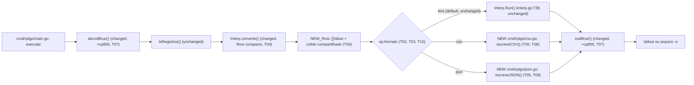

# Implementation Plan

## Request Summary
- Objective: add `--format csv|json` output modes to `rptgo` (bypassing the pagination/break-cascade text engine while preserving the current `--format text`/default output byte-for-byte), replace the `Row` in-memory representation with a more compact shape with zero observable output change, add a CP850 code-page table to `--encoding`, and add two didactic `examples/` scripts plus a rewritten README "primeiros passos" section.
- Scope: in — `--format csv|json`; `Row` memory optimization; `--encoding cp850`; `examples/` (2 scripts+datasets); README updates. Out — `.rp` grammar/mask/date/break-cascade semantics for text mode, any format beyond csv/json/text, any network/HTTP/API surface, any third-party dependency.
- Tier: standard
- Architecture references: `/home/denis/rptgo/AGENTS.md`, `/home/denis/rptgo/docs/agents/architecture.md`, `/home/denis/rptgo/docs/agents/domain_rules.md`, `/home/denis/rptgo/docs/agents/coding_guidelines.md` (also consulted: `docs/agents/api_contracts.md`, `docs/agents/data_model.md`, `docs/agents/dependencies.md`)

## AS IS — Componentes impactados

```mermaid
flowchart LR
  CLI["cmd/rptgo/main.go: executar"] --> Decod["decodificar() (main.go:123)"]
  Decod --> LeReg["leRegistros() (main.go:229)"]
  LeReg --> Conv["Interp.converte() (interp.go:72)"]
  Conv --> Rows["Registros em memoria<br/>Row = map[string]Value"]
  Rows --> Run["Interp.Run() (interp.go:739)"]
  Run --> Cod["codificar() (main.go:136)"]
  Cod --> Out["stdout ou arquivo -o"]
```

Every run today goes through a single path: decode bytes → split records → type-coerce into a `Row = map[string]Value` → run the full pagination/break-cascade text engine (`Interp.Run`) → encode. There is no branch point for an alternate output shape, `Row` is a per-record map (one hash map allocation per input record), and `--encoding` only recognizes `utf-8`/`latin-1` (verified: `internal/report/interp.go:12,72-92,739-873`, `cmd/rptgo/main.go:90-150`).

## TO BE — Componentes propostos

`NEW_Row` (T04) realizes RF-07: a per-record `[]Value` slice plus a column-name→index map shared once per run on `Interp`, with zero observable output change in any mode. `Interp.LinhasOrdenadas()` (T05) exposes sorted-but-not-event-executed records to `cmd/rptgo`, backing `escreveCSV`/`escreveJSON` (T08/T09), which realize RF-01/RF-02/RF-04/RF-06 by bypassing `Run()` entirely. `decodificar`/`codificar` are changed, not replaced, to add the CP850 table (T06/T07), realizing RF-08/RF-09/CT-03. The `--format text` branch (`Run()`) is untouched, realizing RF-03; `op.formato` dispatch and its validation (T02/T03/T10) realize CT-01/CT-02/RF-05.

## Tasks

### T01 — Golden baseline regression tests for current text-mode output
- **Files**: `internal/report/golden_test.go` (new), `internal/report/testdata/golden/*.rp` + `*.txt` (new, minimal fixtures), `cmd/rptgo/main_test.go` (new, `executar()`-level baseline for a couple of flag combinations: default, `--form-feed`, `--newline crlf`, `--header sim`)
- **Change**: this repository has zero `*_test.go` files today (`AGENTS.md:19`). Before touching `Row` or wiring `--format`, commit a small set of representative script+data fixtures (pinning `RPT_NOW` via `t.Setenv`) and tests that call `report.NovoInterp(...).Run()` / `executar(...)` and assert the exact current output. This is the safety net every later task's "byte-for-byte identical" AC is checked against.
- **Covers**: RF-03 (baseline), RF-07 (pre-change reference)
- **Tests**: `internal/report/golden_test.go` — `TestGoldenTextoAtual` (captures today's output for each fixture); `cmd/rptgo/main_test.go` — `TestExecutarPadraoAtual`.
- **Risk**: Low — purely additive, no production code touched.
- **Dependencies**: none

### T02 — Add `--format <text|csv|json>` flag with validation (CT-01)
- **Files**: `cmd/rptgo/main.go`
- **Change**: add `formato string` to `opcoes` (default `"text"` in `analisaArgs`'s initial literal); add a `case "--format":` branch in `analisaArgs` reading the next arg and validating it is one of `text`/`csv`/`json` — on mismatch, return `fmt.Errorf("valor inválido para --format: %s", v)` the same way the existing unknown-flag branch does (`cmd/rptgo/main.go:217-219`).
- **Covers**: RF-01 (trigger), RF-02 (trigger), RF-03 (default), CT-01
- **Tests**: `cmd/rptgo/main_test.go` — `TestAnalisaArgsFormat` table test: no flag → `"text"`; `--format csv`/`json`/`text` → accepted; `--format xml` → error, and `executar()` with `--format xml` exits 2 with `rptgo: ` prefix on stderr.
- **Risk**: Low
- **Dependencies**: none

### T03 — Reject `--format csv|json` + `--form-feed` at validation time (RF-05, CT-02)
- **Files**: `cmd/rptgo/main.go`
- **Change**: at the end of `analisaArgs` (after the arg loop, before `return op, pos, nil`), if `op.formato` is `"csv"` or `"json"` and `op.formFeed` is true, return an error (`fmt.Errorf("--format %s não pode ser combinado com --form-feed", op.formato)`). This runs before any script/data I/O in `executar` (`cmd/rptgo/main.go:38-42`), so no partial output is ever written, satisfying CT-02's ordering requirement regardless of flag order on the command line.
- **Covers**: RF-05, CT-02
- **Tests**: `cmd/rptgo/main_test.go` — `TestFormatFormFeedRejeitado`: `rptgo --format csv --form-feed script.rp dados.txt` (and the reverse flag order) exits 2, stderr matches `rptgo: `, stdout is empty, and no `-o` file is created/written when `-o` is also given.
- **Risk**: Low
- **Dependencies**: T02 (same file/function, needs `op.formato`)

### T04 — Replace `Row` map with a compact slice + shared column index (RF-07)
- **Files**: `internal/report/interp.go`
- **Change**: replace `type Row = map[string]Value` with `type Row = []Value` (positional: index `j` matches `it.S.Input[j]`, the same order `converte` already iterates). Add `colIdx map[string]int` to `Interp`, built once in `NovoInterp` from `s.Input` (`colIdx[c.Name] = j`). Update `converte` to build `r := make(Row, len(cols))` and assign `r[j] = v` instead of `r[col.Name] = v`. Update the single read site, `ev`'s `ColExpr` case (`internal/report/interp.go:173-175`): `if v, ok := it.row[x.Name]; ok` becomes `if j, ok := it.colIdx[x.Name]; ok { return it.row[j], nil }`. No other function reads/writes `Row` by key (`chama`'s aggregate loop only reassigns `it.row = r` wholesale; `chave`/`ordena`/`Run` only pass `Row` values around) — confirmed by `grep -n "it.row\[" internal/report/*.go` returning only the one site above.
- **Covers**: RF-07
- **Tests**: `internal/report/interp_test.go` — `TestRowCompactoSaidaIdentica`: for every fixture in `internal/report/testdata/golden/`, assert `Run()`'s output after this change is byte-for-byte identical to the T01 golden baseline (same fixtures, same `RPT_NOW`).
- **Risk**: High — `Row`/`colIdx` are read from the one evaluation hot path used by every expression in the engine (sort keys, `print`, aggregates, `if`); a missed call site silently breaks every script that references a column by name.
- **Dependencies**: T01

### T05 — Export `Interp.LinhasOrdenadas()` (no event execution)
- **Files**: `internal/report/interp.go`
- **Change**: add `func (it *Interp) LinhasOrdenadas() []Row { it.ordena(); return it.rows }`. Calls only `ordena()` (`internal/report/interp.go:687-736`, pure comparison/reordering of `it.rows`, driven solely by `it.S.Sort`) — never `exec`, `Run`, or anything touching `before`/`after`/`header`/`footer`/`detail`, `vars`, `pageno`, or pagination state. `ordena()` is idempotent (stable sort on an already-sorted slice is a no-op), so calling it a second time (e.g. if `Run()` is also called in the same process) is safe.
- **Covers**: RF-04(a) — supports CSV/JSON row ordering without the event cascade.
- **Tests**: `internal/report/interp_test.go` — `TestLinhasOrdenadasSemEventos`: script with 2 sort levels, each with `before`/`after` sections containing a `set` side effect; after calling `LinhasOrdenadas()`, assert `it.vars` is still empty, `it.pageno == 0`, and the returned `[]Row` order matches the `sort` clause (including a `desc` level).
- **Risk**: Medium — new exported surface; must not accidentally share mutable state with a later `Run()` call on the same `Interp` (not a real usage pattern in `cmd/rptgo`, but worth the explicit test).
- **Dependencies**: T04

### T06 — CP850 code-page table (RF-08, RF-09)
- **Files**: `cmd/rptgo/cp850.go` (new)
- **Change**: add `var cp850ParaRune [256]rune` with the standard public IBM/DOS CP850 ("multilingual Latin I") byte→code-point assignment for all 256 byte values (0x00–0x7F = ASCII, 0x80–0xFF = the CP850-specific accented/box-drawing/symbol block), sourced from a publicly documented CP850 code-page reference. Derive `var cp850ParaByte = map[rune]byte{}` via an `init()` that inverts `cp850ParaRune` (last byte wins on any duplicate rune, matching the inverse-mapping intent of RF-09).
- **Covers**: RF-08, RF-09
- **Tests**: `cmd/rptgo/cp850_test.go` — `TestCP850Tabela256`: all 256 entries non-zero/defined; `TestCP850DivergeDeLatin1`: for every byte 0x80–0xFF where the standard CP850 and latin-1 code points differ, `cp850ParaRune[b] != rune(b)`; `TestCP850RoundTrip`: for all 256 byte values `b`, encoding `cp850ParaRune[b]` back through `cp850ParaByte` yields `b`.
- **Risk**: Medium — correctness depends entirely on transcribing a 256-entry table accurately from a public source; a single wrong entry fails RF-08/RF-09's AC for that byte and is easy to miss without the full round-trip test.
- **Dependencies**: none

### T07 — Wire `cp850` into `decodificar`/`codificar` (CT-03)
- **Files**: `cmd/rptgo/main.go`
- **Change**: add `case "cp850":` to both `decodificar` (`cmd/rptgo/main.go:123-134`) and `codificar` (`cmd/rptgo/main.go:136-150`), placed alongside the existing `latin-1`/`iso-8859-1` case (same `strings.ToLower(enc)` switch, so matching stays case-insensitive per CT-03). Decode: `r[i] = cp850ParaRune[c]` per input byte. Encode: look up each rune in `cp850ParaByte`; on miss, fall back to `'?'` (byte `0x3F`), mirroring the existing latin-1 branch's `r > 255 → '?'` fallback (`cmd/rptgo/main.go:141-144`) rather than erroring.
- **Covers**: RF-08, RF-09, CT-03
- **Tests**: `cmd/rptgo/main_test.go` — `TestEncodingCP850`: `decodificar`/`codificar` round-trip through `executar()` end-to-end (`--encoding cp850` script+data fixture containing bytes in the 0x80–0xFF range) and compare against `cp850_test.go`'s table directly.
- **Risk**: Low
- **Dependencies**: T03 (same file, last editor), T06 (needs the table)

### T08 — CSV serializer (RF-01, supports RF-04/RF-06)
- **Files**: `cmd/rptgo/csv.go` (new)
- **Change**: `func escreveCSV(w io.Writer, s *report.Script, rows []report.Row) error`, using stdlib `encoding/csv.Writer` (default comma delimiter — explicitly NOT `s.Separator`, which is an input-data concept) for RFC 4180-compliant quoting. Write one header record from `s.Input[i].Name`. For each row, for each `j, col := range s.Input`: `v := row[j]`; if `v == nil` → `""`; else switch on `col.Type`: `date`/`ldate` → `v.(time.Time).Format("2006-01-02")` (bare ISO-8601, identical for both types, bypassing `FmtData`/`DATEFMT`/`CENTURY_CUTOFF` entirely per RF-01); int-family types (`tiposInt` set) → `strconv.FormatInt`; float-family (`tiposFlt` set) → `strconv.FormatFloat(f, 'f', -1, 64)` (shortest round-trip, per SPEC FLEXIBLE); `bool` (defensive — see Open Questions) → `"true"`/`"false"`; else → the string value as-is (`csv.Writer` applies RFC 4180 quoting automatically whenever a field contains a comma, `"`, or `\n`/`\r`). Only reads `s.Input`; never reads `s.Width`/`s.Length`/`s.Top`/`s.Bottom`/`s.Left` (RF-06).
- **Covers**: RF-01, RF-04(b) (fed only by sorted rows, never by event-section output), RF-06
- **Tests**: `cmd/rptgo/csv_test.go` — `TestEscreveCSVHeaderEContagem` (N records → N+1 lines, header = declared column names); `TestEscreveCSVQuoting` (fields containing `,`/`"`/`\n` round-trip through `encoding/csv.Reader`); `TestEscreveCSVDatasISO` (both `date` and `ldate` columns match `^\d{4}-\d{2}-\d{2}$` regardless of `DATEFMT`/`CENTURY_CUTOFF` env overrides).
- **Risk**: Medium — must not accidentally use `s.Separator` or call into `FmtData`/`FmtMascara` for dates/numbers (would silently reintroduce the `DATEFMT`-driven rendering RF-01 explicitly overrides).
- **Dependencies**: T05

### T09 — JSON serializer (RF-02, supports RF-04/RF-06)
- **Files**: `cmd/rptgo/json.go` (new)
- **Change**: `func escreveJSON(w io.Writer, s *report.Script, rows []report.Row) error`. Do NOT pass raw `time.Time`/heterogeneous `any` values straight to `encoding/json.Marshal` on a `map[string]any` — Go's default `time.Time` JSON encoding is RFC 3339 with a time component, not the bare `YYYY-MM-DD` RF-02 requires, and Go sorts map keys alphabetically rather than preserving `s.Input` declared order. Instead, for each row build an ordered byte sequence manually: write `{`, then for each `j, col := range s.Input`: marshal `col.Name` via `json.Marshal` (correct escaping), `:`, then the value — `v == nil` → literal `null`; `date`/`ldate` → `json.Marshal(v.(time.Time).Format("2006-01-02"))` (quoted ISO string); int-family → `json.Marshal(v.(int64))`; float-family → `json.Marshal(v.(float64))`; `bool` (defensive) → `json.Marshal(v.(bool))`; else → `json.Marshal(v.(string))`; comma-join fields, close `}`; wrap all row objects in a top-level `[...]` array (empty-record edge case not reachable — `Run`/`LinhasOrdenadas` already require ≥1 row via `verificaEventos`/data presence upstream, same as text mode). Never reads `s.Width`/`s.Length`/`s.Top`/`s.Bottom`/`s.Left` (RF-06).
- **Covers**: RF-02, RF-04(b), RF-06
- **Tests**: `cmd/rptgo/json_test.go` — `TestEscreveJSONEstrutura` (`json.Valid` + `json.Unmarshal` into `[]map[string]any`, exactly N objects, keys exactly match `s.Input` names); `TestEscreveJSONTipos` (null for nil fields, `^\d{4}-\d{2}-\d{2}$` for date/ldate via regex on the raw JSON string before unmarshal, numeric fields unmarshal as `float64` per `encoding/json`'s default number type, never as a JSON string).
- **Risk**: Medium — the `time.Time`-via-`json.Marshal` pitfall above is easy to reintroduce if a future edit switches to a generic `map[string]any` + `json.Marshal` approach; the dedicated date-regex test guards against that regression.
- **Dependencies**: T08 (same new-package sibling file `cmd/rptgo`, but independent `.go` file — ordered after T08 only for review sequencing, no symbol dependency)

### T10 — Wire `--format csv/json` dispatch into `executar()` (RF-01, RF-02, RF-03, RF-04, RF-06, CT-01)
- **Files**: `cmd/rptgo/main.go`
- **Change**: after `it, err := report.NovoInterp(...)` (`cmd/rptgo/main.go:95-99`), branch on `op.formato`: `"text"` (default) keeps the exact existing `it.Run()` → `strings.ReplaceAll` (crlf) → `codificar` → output sequence untouched (RF-03); `"csv"`/`"json"` call `it.LinhasOrdenadas()` then `escreveCSV`/`escreveJSON` into a `bytes.Buffer`, producing the same `string`/`[]byte` shape `it.Run()` would have, then feed it through the *same* existing crlf-conversion + `codificar` + stdout/`-o` tail (`cmd/rptgo/main.go:106-116`) so `--newline`/`--encoding` (including the new `cp850`) apply uniformly to every `--format` value (see Assumptions).
- **Covers**: RF-01, RF-02, RF-03 (must remain untouched for the `"text"` branch — the highest-risk regression in this feature), RF-04 (end-to-end), RF-06 (end-to-end), CT-01 (dispatch)
- **Tests**: `cmd/rptgo/main_test.go` — `TestExecutarFormatoTextoInalterado` (re-runs every T01 golden fixture through the post-change `executar()` with no `--format`/`--format text` and asserts byte-for-byte identity with the T01 baseline — the direct RF-03 AC); `TestExecutarFormatoCSV`/`TestExecutarFormatoJSON` (end-to-end exit code 0, correct content); `TestExecutarFormatoOrdemESort` (RF-04: script with `before`/`after` side-effecting `set` statements and a `sort` clause — csv/json output is in sort order and contains no trace of header/footer/event-only content).
- **Risk**: High — this is the single integration point where a mistake could silently break the RF-03 byte-for-byte guarantee for the default/most-used code path.
- **Dependencies**: T07 (same file, last editor), T08, T09

### T11 — Synthetic 200k-record dataset generator + memory benchmark (RNF-01)
- **Files**: `internal/report/testdata/gerador200k_test.go` (new, fixed-seed `math/rand` generator reusing the T12 example's column schema), `internal/report/bench_test.go` (new, `BenchmarkConverte200k` using `testing.B` + `-benchmem`)
- **Change**: commit a deterministic (fixed seed) 200,000-record synthetic dataset generator whose schema matches the RF-10 example (T12) `input` section. Add a Go benchmark that calls `Interp.converte` (via `NovoInterp`) on the generated dataset and reports `AllocedBytesPerOp`/peak heap via `runtime.MemStats` snapshots immediately before/after the call. Document in a code comment the exact reproduction procedure: run `go test -bench=Converte200k -benchmem ./internal/report/...` once on the commit immediately before T04 (old `map[string]Value` `Row`) and once after (new `[]Value` `Row`), comparing `B/op`/`allocs/op` — no specific threshold required, any reduction satisfies the AC.
- **Covers**: RNF-01
- **Tests**: the benchmark itself is the test artifact; AC is validated by the documented before/after procedure, not by a pass/fail assertion (Go benchmarks don't assert).
- **Risk**: Medium — benchmark noise; mitigated by comparing allocation counts (`-benchmem`), which are deterministic, rather than wall-clock time.
- **Dependencies**: T04 (new `Row` shape to benchmark), T12 (schema reuse)

### T12 — `examples/relatorio-vendas-regiao/`: 1 break level + total (RF-10)
- **Files**: `examples/relatorio-vendas-regiao/relatorio.rp` (new), `examples/relatorio-vendas-regiao/dados.txt` (new)
- **Change**: author a self-contained, fictional `.rp` script (generic "sales by region" scenario, no `today`/`hour` calls — kept reproducible per RF-12's FLEXIBLE guidance) with one `sort`/break level and an `after <level>` section printing at least one `total`/`count` accumulator, plus a matching fictional dataset.
- **Covers**: RF-10
- **Tests**: `cmd/rptgo/examples_test.go` — `TestExemploVendasRegiao`: runs `executar()` against the committed files, asserts exit code 0 and that the output contains the `after`-level total line.
- **Risk**: Low
- **Dependencies**: none

### T13 — `examples/relatorio-estoque-categoria/`: 2+ cascading breaks + aggregate (RF-11)
- **Files**: `examples/relatorio-estoque-categoria/relatorio.rp` (new), `examples/relatorio-estoque-categoria/dados.txt` (new)
- **Change**: author a second self-contained, fictional `.rp` script ("inventory by category" scenario) with 2+ names in its `sort` clause, each with a matching `before`/`after` section, and at least one `after` section calling `count`, `total`, or `avg`; matching fictional dataset.
- **Covers**: RF-11
- **Tests**: `cmd/rptgo/examples_test.go` — `TestExemploEstoqueCategoria`: exit code 0, script declares ≥2 sort names with matching `before`/`after`, output contains at least one aggregate-derived value.
- **Risk**: Low
- **Dependencies**: none

### T14 — README: `--format`/`--encoding cp850` reference + "Estrutura" + close resolved gaps (CT-01, CT-03)
- **Files**: `README.md`
- **Change**: in `## Uso`, document `--format text|csv|json` (default `text`) and add `cp850` to the `--encoding` value list; in `## Estrutura`, add `cmd/rptgo/cp850.go`, `cmd/rptgo/csv.go`, `cmd/rptgo/json.go` to the file tree; in `## O que ainda não está aqui` (`README.md:102-108`), remove the two now-resolved bullets ("Saída alternativa em CSV/JSON" and the CP850 code-page bullet), keeping the still-true third bullet about out-of-scope data-source sections.
- **Covers**: CT-01, CT-03 (documentation)
- **Tests**: none (prose) — AC: `grep -i "CSV/JSON\|CP850" README.md` after the change returns no match inside the "ainda não está aqui" section (the new "Uso"/"Estrutura" mentions are expected matches elsewhere).
- **Risk**: Low
- **Dependencies**: T10 (flags must exist to document), T07 (cp850 must exist to document)

### T15 — README "Primeiros passos" section + reproducibility test (RF-12)
- **Files**: `README.md`, `cmd/rptgo/readme_test.go` (new)
- **Change**: add a new "## Primeiros passos" section (placed after `## Uso`, before `## A linguagem do script`) showing the exact command line to run the T12 example from a clean checkout (`rptgo examples/relatorio-vendas-regiao/relatorio.rp examples/relatorio-vendas-regiao/dados.txt`, chosen because it avoids `today`/`hour` per the FLEXIBLE reproducibility guidance) and the exact expected output (or its exact first/last lines if long).
- **Covers**: RF-12
- **Tests**: `cmd/rptgo/readme_test.go` — `TestReadmePrimeirosPassos`: extracts the literal command and expected-output block documented in `README.md` (or re-embeds the same literal text as a Go string constant kept next to the test, with a comment pointing back at the README section) and asserts it matches running `executar()` against the committed `examples/relatorio-vendas-regiao/` files exactly, with no manual edits.
- **Risk**: Medium — documentation/behavior drift over time; mitigated by the dedicated test above, which fails if the example's output ever changes without the README being updated in the same change.
- **Dependencies**: T12 (example content), T14 (same file, last editor)

## Execution Phases
| Phase | Tasks | Parallel-safe? |
|-------|-------|----------------|
| 1 | T01, T02, T06, T12, T13 | Yes — disjoint files (new test fixtures, `main.go` flag add, new `cp850.go`, two new `examples/` dirs) |
| 2 | T03, T04 | Yes — `main.go` (T03) vs `interp.go` (T04), disjoint |
| 3 | T05, T07, T11 | Yes — `interp.go` (T05) vs `main.go` (T07) vs new `bench_test.go` (T11), disjoint |
| 4 | T08, T09 | Yes — `csv.go` vs `json.go`, disjoint files |
| 5 | T10 | Single task (needs T07/T08/T09 all landed in `main.go`) |
| 6 | T14 | Single task (`README.md`, needs T10/T07 behavior to document) |
| 7 | T15 | Single task (`README.md`, sequential after T14; needs T12 content) |

## Contracts emitted

None. The SPEC's `### Contracts` subsection (CT-01, CT-02, CT-03) describes this repository's only contract surface — CLI flags and process exit codes (`docs/agents/api_contracts.md:9`: "No HTTP surface exists... no OpenAPI/GraphQL schema") — not a REST, gRPC, or asynchronous-event interface. None of `openapi.yaml`/`service.proto`/`asyncapi.yaml` applies to a CLI flag/exit-code contract, so no formal contract artifact is generated. CT-01/CT-02/CT-03 are instead captured as RIGID requirements with explicit, testable AC traced directly into tasks T02 (CT-01), T03 (CT-02), T07 (CT-03), T10 (CT-01 integration), and T14 (CT-01/CT-03 documentation).

## Risks
| Risk | Blast radius | Mitigation | Rollback |
|------|-------------|------------|----------|
| `Row` refactor (T04) silently changes text-mode output | Every script/data pair in every `--format`, this repo's single highest-value guarantee (RF-03) | T01 golden baseline committed first; T04/T10 both re-run every golden fixture byte-for-byte before/after | `git revert` the T04 commit — no persisted state, no migration, pure in-memory type change |
| CP850 table (T06) has a transcription error | Garbled output for every byte in the error's range when `--encoding cp850` is used | Full 256-value round-trip test (T06) plus divergence-from-latin-1 test, sourced from a public standard table only | `git revert` T06/T07 — `cp850` simply becomes unavailable again, same as today |
| JSON serializer (T09) regresses to generic `json.Marshal` on `time.Time`/map, reintroducing RFC 3339 dates or alphabetical key order | All `--format json` consumers get malformed dates / unexpected key order | Dedicated date-regex + key-order tests in T09; design note in the task body calling out the exact pitfall | `git revert` T09 |
| CSV/JSON path (T08/T09/T10) accidentally executes an event section or reads layout clauses | RF-04(b)/RF-06 violated — event side effects or layout-driven output leak into csv/json | T05's `LinhasOrdenadas()` never calls `exec`/`Run`; T08/T09 only read `s.Input`; T10's integration test (`TestExecutarFormatoOrdemESort`) checks for event-only content | `git revert` the offending commit |
| First-ever test suite in this repo (T01 onward) has no established harness/CI | Process risk — no existing pattern to follow, easy to get Go test conventions subtly wrong | T01 establishes the pattern (fixtures under `testdata/`, `t.Setenv("RPT_NOW", ...)`) that every later task's tests copy | N/A — tests are additive |

## Open Questions
- RF-02 requires `bool`-typed column values to serialize as a JSON boolean, but no `.rp` input column type named `bool` is ever coerced into a Go `bool` anywhere in `Interp.tipa()` (`internal/report/interp.go:94-138`) — `domain_rules.md`'s own coercion table lists only `numeric/integer/long/int`, `float/amount/double/real/huge`, `date/ldate`, and `string` (default); `ast.go:86`'s comment mentions `bool` as an aspirational type in `InputCol.Type`'s free-text comment, but no switch branch anywhere ever matches it, so a column declared `bool` today silently falls through to the generic string-trim branch. This SPEC clause and the resolved architecture disagree: adding real `bool` coercion to `tipa()` would be a domain-rule/type-system change the SPEC's own `Scope` "Out" bullet does not authorize, and could change today's string-fallback text-mode output for any script that already declares a `bool` column — breaking RF-03. This plan (T09) implements the JSON serializer to honor the rule defensively (switch on a Go `bool` value if one is ever produced) without adding new input-column coercion, leaving RF-02's `bool` clause correct-but-currently-unreachable via normal `input` declarations. Confirm with the developer whether real `bool` column-type support belongs in this feature or a follow-up.
- SPEC/CT do not state whether `--newline`/`--encoding` (including the new `cp850`) should still apply to `--format csv/json` output. T10 assumes yes (the generic I/O tail is shared across all three formats) since nothing in RIGID excludes it and the architecture explicitly keeps all encoding/newline concerns in `cmd/rptgo`. Confirm this is the intended behavior.
- RF-01 specifies RFC 4180 quoting and the ISO-8601 date override but is silent on how a `nil` field or a (currently unreachable, see above) `bool` field should render in CSV specifically, unlike RF-02's explicit JSON rules. T08 assumes `nil → ""` (matching the existing text-mode `nil → ""` convention at `internal/report/interp.go:634-636`) and `bool → "true"/"false"` literal text. Confirm these defaults are acceptable.

## Assumptions
- `encoding/csv.Writer`'s default comma delimiter and automatic RFC 4180 quoting satisfy RF-01's quoting AC without a hand-rolled quoter — verified: Go stdlib, already permitted under `dependencies.md:7`'s stdlib-only constraint.
- The CP850 byte→rune table (T06) will be transcribed from a publicly documented IBM/DOS CP850 ("multilingual Latin I") code-page reference — [UNVERIFIED]: the implementer must source and cross-check the exact 256 entries against a public reference at implementation time; this plan only specifies the shape (`[256]rune` + derived `map[rune]byte`) and the round-trip/divergence tests that must pass.
- `--format` matching is case-sensitive (`text`/`csv`/`json` exactly) — CT-01 does not request case-insensitivity the way CT-03 explicitly does for `--encoding`; [UNVERIFIED] confirm with the developer if consistency with `--encoding`'s case-insensitive matching is desired instead.
- JSON numeric formatting uses Go's default `encoding/json` float64/int64 marshaling (shortest round-trip), matching the SPEC's own FLEXIBLE suggestion — no AC requires a specific decimal representation.
- The 200,000-record RNF-01 benchmark fixture (T11) reuses the RF-10 example's (T12) column schema rather than the literal `examples/` files, per the SPEC's "derived from one of the RF-10/RF-11 example schemas" wording (schema reuse, not file reuse).
