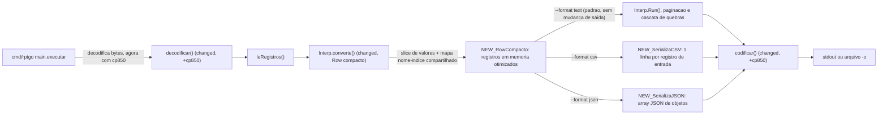

# SPEC: csv-json-output-docs

## Metadata
- Source: developer description via /plan
- Service: rptgo (module `rptgo`, Go 1.25, stdlib-only — verified at `go.mod:1-3`)
- Tier: standard
- Version: 1.2
- Architecture references: `/home/denis/rptgo/AGENTS.md`, `/home/denis/rptgo/docs/agents/architecture.md`, `/home/denis/rptgo/docs/agents/domain_rules.md`, `/home/denis/rptgo/docs/agents/coding_guidelines.md` (also consulted: `docs/agents/api_contracts.md`, `docs/agents/data_model.md`, `docs/agents/dependencies.md`)

## Context
`rptgo` is a CLI interpreter for a fixed-column report-definition language (`.rp` scripts). Today it only produces paginated fixed-width text: `cmd/rptgo/main.go` parses CLI args, decodes script/data bytes, calls `report.NovoInterp`/`Interp.Run()` (`internal/report/interp.go:739`), and writes the resulting paginated string — confirmed by `AGENTS.md`'s own troubleshooting table: *"Need CSV/JSON output instead of fixed-width text — not supported"* and *"Garbled bytes with `--encoding` on a dot-matrix code page (e.g. CP850) — not supported"* (`AGENTS.md:79-80`), and by `README.md:102-106` ("O que ainda não está aqui").

Internally, one input record is a `Row = map[string]Value` (`internal/report/interp.go:12`), built field-by-field in `Interp.converte` (`internal/report/interp.go:72-92`). `--encoding` only implements `utf-8` (default, bytes passed through) and `latin-1`/`iso-8859-1` (direct byte↔rune mapping) in `decodificar`/`codificar` (`cmd/rptgo/main.go:123-150`); any other value falls through to the utf-8 branch silently. The project is `stdlib-only` with zero `go.sum` entries (`docs/agents/dependencies.md:7`), so a CP850 table cannot be imported from a third-party package (e.g. `golang.org/x/text/encoding/charmap`) — it must be a hand-written 256-entry table inside this module, consistent with `decodificar`/`codificar` already living in `cmd/rptgo/main.go`, the layer architecture.md assigns ownership of "encoding conversion" to (`docs/agents/architecture.md:34`).

This feature adds `--format csv|json` output modes, optimizes the `Row` memory representation, adds a CP850 code-page table to `--encoding`, and adds a didactic `examples/` directory plus a rewritten README "primeiros passos" section — all while keeping the current default paginated-text behavior byte-for-byte unchanged. No HTTP/API surface exists in this repo (`docs/agents/api_contracts.md:9`); the CLI flag/exit-code set is the only contract surface, so `UI Requirements` is omitted below (not applicable) and the CLI contract is captured under `Contracts`.

## AS IS — Estado atual

```mermaid
flowchart LR
  CLI["cmd/rptgo main.executar"] -->|"decodifica bytes (encoding)"| Decod["decodificar() main.go:123"]
  Decod -->|"separa linhas e campos"| LeReg["leRegistros() main.go:229"]
  LeReg -->|"tipa cada campo por InputCol"| Conv["Interp.converte() interp.go:72"]
  Conv -->|"grava Row = mapa nome-valor"| Rows["Registros em memoria, Row = map string->Value"]
  Rows --> Run["Interp.Run(), paginacao e cascata de quebras, interp.go:739"]
  Run -->|"texto final paginado"| Cod["codificar() main.go:136"]
  Cod --> Out["stdout ou arquivo -o"]
```

Today every run goes through the same single path: decode → split records → type-coerce into a `Row` map → run the full pagination/break-cascade text engine → encode. There is no branch point for an alternate output shape, and `--encoding` only recognizes `utf-8`/`latin-1`.

## TO BE — Estado proposto

`NEW_RowCompacto` realizes RF-07 (compact in-memory record representation, no observable output change). `NEW_SerializaCSV`/`NEW_SerializaJSON` realize RF-01/RF-02/RF-04, bypassing the pagination/break-cascade engine entirely. `decodificar`/`codificar` are changed (not replaced) to add the CP850 table, realizing RF-08/RF-09/CT-03. The `--format text` branch is unchanged, realizing RF-03.

## Scope
- **In**: `--format csv|json` output modes; `Row` memory representation change with zero observable output change; CP850 support in `--encoding` (read and write); `examples/` directory with 2 didactic scripts+datasets; rewritten `README.md` "primeiros passos" section.
- **Out**: any change to the `.rp` script language grammar, `using` mask notation, date semantics, or break-cascade/aggregate-function semantics for the default text mode; any new output format beyond CSV/JSON/text; any network/HTTP/API surface (none exists today, `docs/agents/api_contracts.md:9`); any third-party dependency (project remains stdlib-only, `docs/agents/dependencies.md:7`).

## RIGID (Non-Negotiable)

### Functional Requirements

- RF-01 [Event-driven]: When the CLI is invoked with `--format csv`, the system shall produce, instead of paginated fixed-width text, a CSV document with exactly one data row per input record (not per printed page line), columns in the same order declared in the script's `input` section, preceded by one header row containing the column names, using RFC 4180 comma-separated quoting (a field is double-quoted, with internal `"` doubled, if and only if it contains the comma, a double quote, or a line break); date-typed column values (both `date` and `ldate` column types) serialize as a bare, unquoted-unless-otherwise-required ISO-8601 `YYYY-MM-DD` string — the same rule and format RF-02 applies to JSON, with no distinction in year width between `date` and `ldate`, intentionally overriding any `DATEFMT`/`CENTURY_CUTOFF`-driven text rendering for CSV output exactly as RF-02 already overrides it for JSON.
  - AC: Given a script with `input a, b, c` and N data records, running with `--format csv` produces a CSV with exactly N+1 lines (1 header + N data rows), header = `a,b,c`, and any field value containing a comma, quote, or newline is RFC 4180-quoted.
  - AC: Every `date`/`ldate` field in CSV output matches `^\d{4}-\d{2}-\d{2}$` (ISO-8601 `YYYY-MM-DD`), identically for both column types, regardless of any `DATEFMT` or `CENTURY_CUTOFF` setting active in the script — the same override RF-02 specifies for JSON applies to CSV.

- RF-02 [Event-driven]: When the CLI is invoked with `--format json`, the system shall produce, instead of paginated fixed-width text, a single JSON array with exactly one JSON object per input record, using the same field names declared in the script's `input` section, where null values serialize as JSON `null`, date values (both `date` and `ldate` column types) serialize as a JSON string in ISO-8601 `YYYY-MM-DD` format, numeric values (`numeric`/`integer`/`long`/`int`/`float`/`amount`/`double`/`real`/`huge`) serialize as a JSON number (never a JSON string), and `bool`-typed values serialize as a JSON boolean.
  - AC: Given a script with `input a, b, c` and N data records, running with `--format json` produces a syntactically valid JSON document whose top-level value is an array of exactly N objects, each with keys exactly `a`, `b`, `c`; every `nil` field value is `null`; every date field is a string matching `^\d{4}-\d{2}-\d{2}$`; every numeric field is a bare JSON number.
  - AC: The ISO-8601 `YYYY-MM-DD` date rule for JSON applies identically to `date` and `ldate` column types, intentionally overriding the text-mode 2-digit/4-digit year distinction (`domain_rules.md`, "Column type → year width"), since that distinction is specific to the fixed-width text renderer and does not apply to JSON serialization.

- RF-03 [Unwanted]: IF no `--format` flag is given, OR `--format text` is given explicitly, THEN the system SHALL NOT alter the paginated fixed-width text output in any way compared to the current behavior.
  - AC: For every script/data pair already exercised informally against the current binary, the output of the new binary run without `--format` (or with `--format text`) is byte-for-byte identical to the current binary's output, including trailing padding, `--form-feed` page breaks, and `--newline` conversion.

- RF-04 [Conditional]: IF `--format` is `csv` or `json`, THEN the system shall: (a) order output records by the script's `sort` clause exactly as it would for text mode (verified at `internal/report/interp.go:740`, `Interp.ordena()`), and (b) not execute any `before`/`after`/`header`/`footer`/`detail` event section — only the `input` column declarations and the `sort` clause are consulted.
  - AC: Given a script whose `detail`/`header`/`footer`/`before`/`after` sections contain a `set` statement with an observable side effect (e.g. incrementing a counter printed elsewhere) and a `sort` clause reordering records, running with `--format csv` or `--format json` emits records in the `sort`-clause order and the output contains no trace of any event-section-only content (e.g. no header/footer text, no aggregate-only values computed only inside `after`).

- RF-05 [Conditional]: IF `--format` is `csv` or `json` AND `--form-feed` is also given, THEN the system shall reject the invocation with a non-zero exit code and SHALL NOT produce any report output, consistent with the existing CLI convention of failing fast on nonsensical flag combinations (`cmd/rptgo/main.go:173-224`, `analisaArgs` returns an error for every invalid combination it already checks, e.g. line 218 "opção desconhecida") rather than silently ignoring or warning (no warning-to-stderr-and-continue code path exists anywhere in `cmd/rptgo/main.go` today).
  - AC: `rptgo --format csv --form-feed script.rp dados.txt` exits with code 2, writes an error message to stderr following the existing `rptgo: <mensagem>` convention (`cmd/rptgo/main.go:40`), and writes nothing to stdout or to `-o`.

- RF-06 [Conditional]: IF `--format` is `csv` or `json`, THEN the script's `width`, `length`, `top margin`/`bottom margin`/`left margin` clauses shall be parsed without error but shall have no effect on the output and shall NOT trigger any warning or error — a single `.rp` script may be reused unmodified for both text and CSV/JSON runs.
  - AC: A script declaring `width 80`, `length 66`, `top margin 2` produces identical CSV/JSON output (ignoring those clauses) whether those clauses are present or removed from the script, and the CLI exit code is 0 in both cases (given valid data).

- RF-07 [Unwanted]: The `Row` in-memory representation (`internal/report/interp.go:12`, currently `map[string]Value` per record) shall be replaced by a more compact representation (e.g. a per-record value slice plus a single column-name→index map shared across all records of a run) — IF this change is made, THEN the system SHALL NOT alter any observable output in any `--format` mode compared to the pre-change behavior.
  - AC: For the same script+data input, text/CSV/JSON output produced before and after the `Row` representation change is byte-for-byte identical in every `--format` mode.

- RF-08 [Optional]: Where `--encoding cp850` is selected for reading, the system shall decode the script file and the data file using a dedicated CP850 code-page byte→rune table (256 entries, one per byte value 0x00–0xFF) instead of the existing utf-8 passthrough or latin-1 direct mapping.
  - AC: For every one of the 256 possible input byte values, decoding with `--encoding cp850` produces the Unicode code point defined by the standard CP850 code page table, and the result differs from the `latin-1` decoding of the same byte for every byte in the 0x80–0xFF range where CP850 and latin-1 diverge.

- RF-09 [Optional]: Where `--encoding cp850` is selected for writing (output text or `-o <file>`), the system shall encode characters back to CP850 bytes using the inverse of the RF-08 table.
  - AC: For every rune present in the CP850 table's 256-entry range, `codificar(decodificar(b, "cp850"), "cp850")` round-trips to the original byte `b` for all 256 byte values (full round-trip property test).

- RF-10 [Event-driven]: The project shall gain an `examples/` directory containing at least one self-contained, fictional `.rp` script and matching dataset demonstrating a report with exactly one break level and at least one total/aggregate accumulator printed in its `after`-level section.
  - AC: `examples/<name-a>/*.rp` + its dataset run successfully with `rptgo` (exit code 0) and produce a report containing at least one `after <level>` total line.

- RF-11 [Event-driven]: The project shall gain a second self-contained, fictional `.rp` script and matching dataset demonstrating a report with 2 or more cascading break levels and at least one aggregate function among `count`/`total`/`avg`.
  - AC: `examples/<name-b>/*.rp` + its dataset run successfully with `rptgo` (exit code 0), the script declares 2+ names in its `sort` clause each with a matching `before`/`after` section, and at least one `after` section calls `count`, `total`, or `avg`.

- RF-12 [Event-driven]: `README.md` shall gain a "primeiros passos" ("getting started") section that runs one of the RF-10/RF-11 examples from a clean checkout, showing the exact command line and the exact expected output (or the exact first/last lines of it, if long), reproducible on re-run.
  - AC: Copy-pasting the documented command (including any required environment variable, e.g. `RPT_NOW`, if the chosen example uses `today`/`hour`) against the committed example files reproduces the documented output exactly, with no manual edits.

### Contracts

- CT-01: New CLI flag `--format <text|csv|json>` (default `text` when omitted), added to `analisaArgs` (`cmd/rptgo/main.go:173-224`) alongside the existing flags; an unrecognized `--format` value is rejected the same way an unknown flag is today (`cmd/rptgo/main.go:217-219`): exit code 2, `rptgo: <mensagem>` on stderr.
- CT-02: `--format csv` or `--format json` combined with `--form-feed` is rejected at argument-validation time (before script/data I/O): exit code 2, `rptgo: <mensagem>` on stderr, no partial output written (realizes RF-05).
- CT-03: `--encoding` accepts a new value `cp850` (alongside existing `utf-8`, `latin-1`/`iso-8859-1`), case-insensitively matched the same way the existing values are (`cmd/rptgo/main.go:124-125`, `strings.ToLower`), applied symmetrically to script decoding, data decoding, and output encoding (realizes RF-08/RF-09).

### Non-Functional Requirements

- RNF-01: The `Row` representation change (RF-07) shall produce a measurable reduction in peak memory used to hold the full in-memory record set for a 200,000-record dataset, compared to the current `map[string]Value`-per-record baseline, measured via a reproducible benchmark (e.g. `runtime.MemStats` before/after `Interp.converte`, or a Go benchmark with `-benchmem`) on the same dataset for both the old and new representation. No fixture of this size exists in the repository today (`AGENTS.md:19`: "no `*_test.go` files anywhere"); this feature shall add a synthetic, reproducible 200,000-record dataset generator (fixed random seed) derived from one of the RF-10/RF-11 example schemas, committed in-repo as source (fixture or generator code), so the benchmark is re-runnable by anyone from a clean checkout.
  - AC: A committed, reproducible generator (fixed seed) or committed fixture produces a 200,000-record dataset whose schema matches one of the RF-10/RF-11 examples; running the benchmark on this dataset with the old (`map[string]Value`) and new (RF-07) `Row` representations shows any measurable reduction in peak memory for the new representation versus the old one — no specific percentage or absolute-byte threshold is required; any reduction greater than zero (outside measurement noise) satisfies this AC.

## FLEXIBLE (Implementation Suggestions)
- Keep the CSV/JSON serializer in `cmd/rptgo` (e.g. `cmd/rptgo/saida.go`), reading `Script.Input` (already exported, `internal/report/ast.go:109`) and a new small exported accessor on `Interp` (e.g. `Interp.LinhasOrdenadas() []Row`) that returns records already sorted per the `sort` clause but without running any event section — this keeps `internal/report` as the sole owner of sort/type-coercion semantics (`docs/agents/architecture.md` layer table) while `cmd/rptgo` keeps owning output-format/I/O concerns.
- `Row` optimization: introduce a shared `map[string]int` column-index built once per run (e.g. on `Interp`), and change the per-record shape to `[]Value`; keep Portuguese naming for the new identifiers (e.g. `indiceColuna`, `valores`) per `docs/agents/coding_guidelines.md` convention 4.
- CP850 table: new file `cmd/rptgo/cp850.go` (same file the other encoding functions live in) with a `[256]rune` decode table and a derived `map[rune]byte` for encoding, built once (`var`/`init`), consistent with the standard public CP850 code page assignment (not derived from any proprietary source).
- Example naming (fictional, generic business scenarios — final names to be confirmed): e.g. `examples/relatorio-vendas-regiao/` (1-level break + totals) and `examples/relatorio-estoque-categoria/` (2-level cascading break + `count`/`total`/`avg`).
- For RF-12 reproducibility, prefer an example that does not call `today`/`hour`, or pin `RPT_NOW` explicitly in the documented command, so the README's literal expected-output text never drifts.
- JSON serialization formatting (indentation vs. compact) is left as an implementation choice since no AC requires exact whitespace — `encoding/json.Marshal` (compact) is sufficient; CSV numeric formatting can use Go's shortest round-trip decimal representation (`strconv.FormatFloat` with `-1` precision) since no `using` mask applies in CSV/JSON mode.

## Acceptance Criteria Summary
| ID | Criterion | Testable? |
|----|-----------|-----------|
| RF-01 | CSV: 1 row/record, header, declared column order, RFC 4180 quoting, ISO-8601 dates | Yes |
| RF-02 | JSON: array of objects, null/ISO-8601/number rules | Yes |
| RF-03 | Default/`--format text` output unchanged, byte-for-byte | Yes |
| RF-04 | CSV/JSON row order = `sort` clause order; no event sections executed | Yes |
| RF-05 | `--format csv\|json` + `--form-feed` → hard error, exit 2, no output | Yes |
| RF-06 | Script layout clauses ignored without error in csv/json mode | Yes |
| RF-07 | Compact `Row` representation, zero observable output change | Yes |
| RF-08 | CP850 decode table, 256/256 byte values mapped | Yes |
| RF-09 | CP850 encode round-trips RF-08's table | Yes |
| RF-10 | `examples/` script: 1 break level + total, generic/fictional | Yes |
| RF-11 | `examples/` script: 2+ cascading breaks + aggregate function | Yes |
| RF-12 | README "primeiros passos": exact command + reproducible output | Yes |
| CT-01 | `--format text\|csv\|json` flag contract, default `text` | Yes |
| CT-02 | `--format csv\|json` + `--form-feed` exit-code contract | Yes |
| CT-03 | `--encoding cp850` accepted value, symmetric read/write | Yes |
| RNF-01 | Measurable memory reduction, synthetic 200k-record dataset (fixed seed, committed generator/fixture) | Yes |
