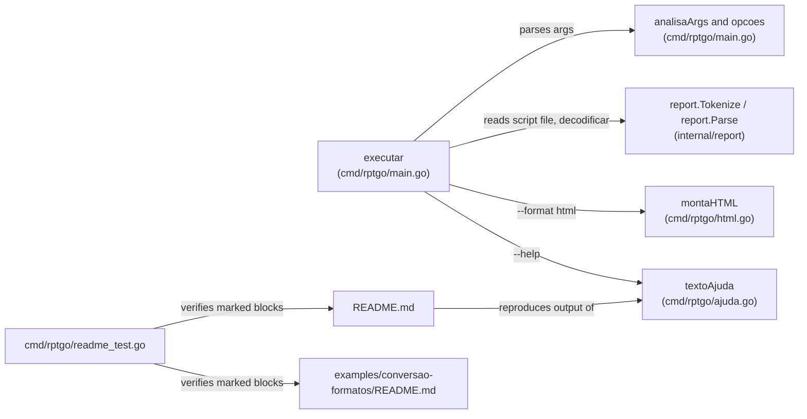
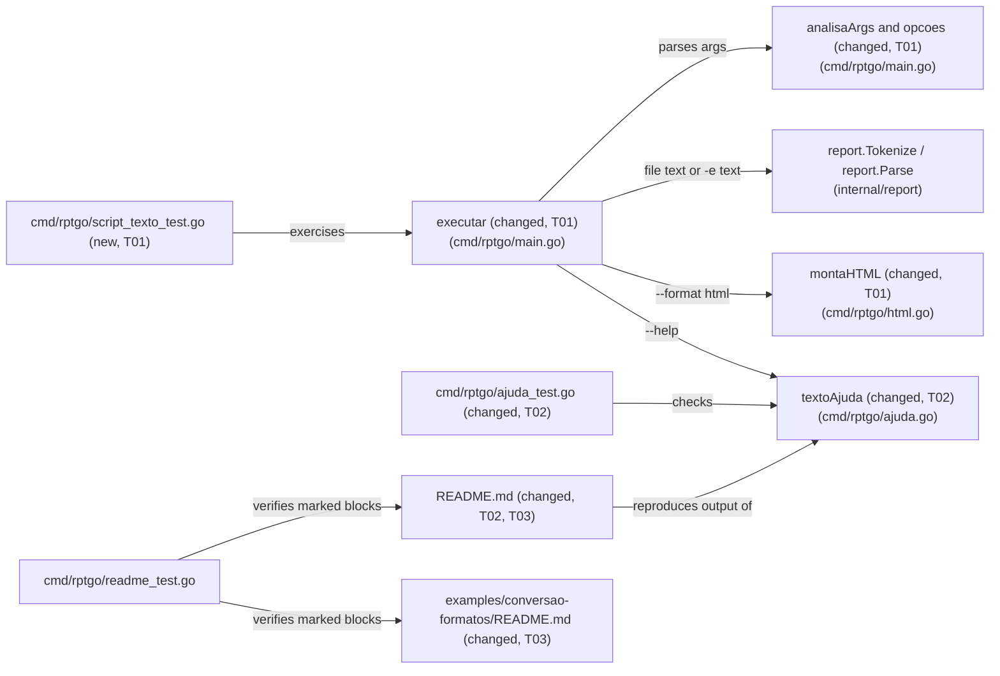

# Implementation Plan

## Request Summary
- Objective: accept the report script on the command line with `-e TEXT` / `--script TEXT`, producing the same output as a `.rp` file with the same text (SPEC `.spec/features/inline-script-option/SPEC.md`, v1.0).
- Scope: in: the new option, positional handling, usage and script errors, `--check`, UTF-8 handling of TEXT, HTML `{{Script}}` / `{{Title}}`, docs in `--help`, `README.md` and `examples/conversao-formatos/README.md`. Out: `--columns`, type inference, `--script=TEXT` / `-eTEXT` forms, `.rp` language changes, `SAIDA-HTML.md`, `REFERENCIA.md`, translation of pt-BR docs, hand edits to `AGENTS.md` / `docs/agents/*`.
- Tier: standard
- Architecture references: `AGENTS.md`, `docs/agents/architecture.md`, `docs/agents/domain_rules.md`, `docs/agents/coding_guidelines.md`, `.claude/rules/bc-harness.md`

## AS IS — Componentes impactados

The script always comes from the first positional argument, is read and decoded in `executar`, and its path feeds `montaHTML`. The `--help` output is reproduced in a verified block of `README.md`.

## TO BE — Componentes propostos

T01 changes option parsing, the script source in `executar` and the HTML globals, with its own tests. T02 changes the help text and the README help block; T03 adds the `-e` examples to both READMEs. `internal/report` is not modified.

## Tasks

### T01 — Accept `-e` / `--script` in the CLI, with tests
- **Files**: `cmd/rptgo/main.go`, `cmd/rptgo/html.go`, `cmd/rptgo/script_texto_test.go` (new)
- **Change**:
  - Layering: all of it stays in `cmd/rptgo`; script parsing remains in `internal/report`, which is not touched (`docs/agents/architecture.md`).
  - `opcoes`: add the script text and a separate presence flag (pt-BR names, e.g. `textoScript string`, `temTextoScript bool`), so `-e ""` counts as present.
  - `analisaArgs`: add `case "-e", "--script"` using the existing `next()` helper; a second occurrence in any spelling returns a pt-BR usage error. After the loop, with the flag set and 2 or more positionals, return a pt-BR usage error. All validation stays in `analisaArgs`, so `erroUso` and exit 2 apply (`docs/agents/coding_guidelines.md`, section 3).
  - `executar`: with the flag set, skip the "falta o arquivo de script" check, `os.ReadFile` and `decodificar` for the script; the only positional is the data file, absent or `-` meaning standard input. Both paths then share the code from `report.DefFonteScript` onward (error context, `--strict`, `--check`, data read). `--encoding` keeps applying to data and output.
  - `montaHTML`: with the flag set, `Script` is `""` and the default title is the literal `rptgo` (not `nomePrograma`); `--title` still overrides. Do not pass an empty path to `filepath.Base` (it returns `.`).
  - Update the package doc comment in `main.go` with the second usage form. Without the flag, behaviour is unchanged.
- **Covers**: RF-01, RF-02, RF-03, RF-04, RF-05, RF-06, RF-07, RF-08, CT-01, RNF-01, RNF-02, RNF-03
- **Tests**: `cmd/rptgo/script_texto_test.go`, table-driven (reuse `executa` and `writeFile`):
  - equivalence with a `.rp` file: stdout and exit code for text, csv, json and html (html with `--title` and a template without `{{Script}}`), `-e` equal to `--script`, `-o FILE` content, multi-line TEXT with and without `--strict`, TEXT equal to the path of an existing `.rp` file (not read);
  - data source: data file, no positional, `-`, positional before and after the pair, nonexistent data file (exit 1, `rptgo: ` prefix);
  - usage errors: the 8 invocations listed in RF-03, each also with `--check` before the first `-e` / `--script`; exit 2, empty stdout, `rptgo: ` prefix, help hint, standard input never read (call `executar` with a reader that records reads), no `-o` file (place `-o FILE` before the script option);
  - script errors: stderr and exit code equal to the file run for a parse error on line 2, an execution-time error and `-e ""`;
  - `--check` and `-r`: valid, invalid, nonexistent data file, standard input not read;
  - encoding: `São` written as `0xE3` (latin-1) and `0xC6` (cp850); latin-1 and cp850 data compared with a `.rp` file saved in that encoding; default encoding passes bytes through; html output stays UTF-8;
  - html: `[{{Script}}]` renders `[]`; default title `rptgo` in a custom and in the built-in template, also with `nomePrograma` changed (restore it after); `--title X` wins; with a script file, `Script` and `Title` stay as today.
- **Risk**: Medium — changes the single execution path used by every invocation.
- **Dependencies**: none

### T02 — Document the option in `--help` and sync the README help block
- **Files**: `cmd/rptgo/ajuda.go`, `cmd/rptgo/ajuda_test.go`, `README.md` (only the `./rptgo --help` expect block)
- **Change**:
  - Keep the first usage line unchanged (`ajuda_test.go` checks it as a prefix); add a second usage line for the `-e TEXTO [ENTRADA.txt | -]` form.
  - Add an option entry containing `-e, --script` that states the text is the whole script, replaces `SCRIPT.rp`, is UTF-8 and is not affected by `--encoding`.
  - Reword the `--encoding` entry so it names what it applies to (the `.rp` file, the data and the output), and the `--title` entry so its default covers `-e` (`rptgo`).
  - Add one example line using `-e`, built with the program name like the other examples.
  - Copy the new help output into the marked block of `README.md`.
  - Extend the option list in `TestAjudaListaTodasAsOpcoes` with `-e, --script` and assert the UTF-8 / `--encoding` statement. All new text in pt-BR.
- **Covers**: RF-09, RF-08, RNF-03
- **Tests**: `cmd/rptgo/ajuda_test.go` — `TestAjudaListaTodasAsOpcoes`; `cmd/rptgo/readme_test.go` — `TestReadmeBlocosConferem` (existing, unchanged)
- **Risk**: Low — text only; the README block must match byte for byte.
- **Dependencies**: none

### T03 — Add verified `-e` examples to both READMEs
- **Files**: `README.md`, `examples/conversao-formatos/README.md`
- **Change**:
  - `README.md`, "Converter entre texto, CSV e JSON": replace the `<(echo ...)` command with a `-e` command in a `<!-- run -->` block followed by `<!-- expect -->`. In "Linha de comando", add the `-e` form to the unmarked usage block.
  - Example page, section "Sem criar o arquivo `.rp`": keep the heading (the anchor at the top of the page points to it); lead with `-e` in a marked run/expect pair; show the piped-data case with `-e` in an unmarked block; remove the sentence "No Windows, grave o script num arquivo." and any other claim that a file is the only way on Windows; add a note on shell quoting of TEXT (e.g. double quotes outside when the script has `separator ';'`).
  - Example page, "Opções de saída e codificação": state that `--encoding` covers the `.rp` file, the data and the output, and that the `-e` text is always UTF-8.
  - Marked commands cannot use pipes or process substitution and must take a data file under `examples/`. Delimited and CSV input are positional and need every column in the script; for a short column list use `--input json` with `examples/conversao-formatos/clientes.json`, or declare all six columns for `clientes.txt` / `clientes.csv`.
  - All additions in pt-BR.
- **Covers**: RF-09, RNF-03, RNF-04
- **Tests**: `cmd/rptgo/readme_test.go` — `TestReadmeBlocosConferem` (existing, runs the new blocks); manual run of the unmarked piped example
- **Risk**: Low — documentation only.
- **Dependencies**: T01, T02

## Execution Phases
| Phase | Tasks | Parallel-safe? |
|-------|-------|----------------|
| 1 | T01, T02 | Yes — disjoint files |
| 2 | T03 | No — needs the behaviour of T01 and shares `README.md` with T02 |

Rollout: no flag or migration. After Phase 2, run `go test ./...`, confirm `go.mod` still has no `require` and no `go.sum` exists, then re-run `/bc-harness:ai-context` as a separate step so `AGENTS.md` and `docs/agents/api_contracts.md` list the option (never by hand, and not part of the implementation diff of T01–T03).

## Risks
| Risk | Blast radius | Mitigation | Rollback |
|------|-------------|------------|----------|
| The new branch in `executar` changes behaviour of file-script runs | Every CLI invocation | Branch only on the presence flag; existing tests pass with unchanged expected values (RF-08) | Revert the T01 commit |
| HTML shows `.` as script name, or the binary name as title | `--format html` with `-e` | Explicit branch in `montaHTML` with literal `rptgo`; test with `nomePrograma` changed | Revert the `html.go` change |
| Empty TEXT treated as absent, so the data file is read as the script | `-e ""` | Presence flag separate from the text; test against an empty `.rp` file | Revert the T01 commit |
| README help block or new run blocks drift from real output | `go test ./...` fails | Help text and README block change in the same task (T02); run `go test ./cmd/rptgo -run 'Readme\|Ajuda'` | Revert the doc commit |
| Generated agent docs stay stale (`api_contracts.md` says `--encoding` applies to the script) | Agent guidance only | Re-run `/bc-harness:ai-context` after the code change | Re-run the command after any revert |

## Open Questions
- `.claude/rules/bc-harness.md` says existing pt-BR docs must be translated to English when next touched; the SPEC (RNF-03, Scope "Out") keeps `README.md`, the example page and the help text in pt-BR and records this as an unconfirmed assumption. The plan follows the SPEC. If the rule should win, the SPEC must change first, and T02/T03 grow into a translation of both files. Not blocking.
- `SAIDA-HTML.md` describes the HTML variables and is out of scope, so it will not mention the `-e` values of `{{Script}}` and `{{Title}}` (RF-07). Impact: documentation gap only; `--help` covers the title default (T02).

## Assumptions
- No contract file is emitted: the only contract (CT-01) is a CLI surface, with no REST, gRPC or async interface.
- `internal/report` needs no change: error context comes from `report.DefFonteScript`, called with the script text before tokenizing (verified at `cmd/rptgo/main.go:86`).
- `--check` already returns before any data read (verified at `cmd/rptgo/main.go:97-100`), so RF-05 needs only the shared path.
- `argsDoComando` handles single- and double-quoted arguments, so a quoted TEXT works in marked blocks (verified at `cmd/rptgo/readme_test.go`).
- `go test ./...` passes before the change (run during planning).
- Operating-system arguments reach the program as UTF-8 on Windows through the Go runtime; behaviour of non-UTF-8 terminals on other systems is [UNVERIFIED] and matches RF-06 ("TEXT bytes are used as received" under the default encoding).
