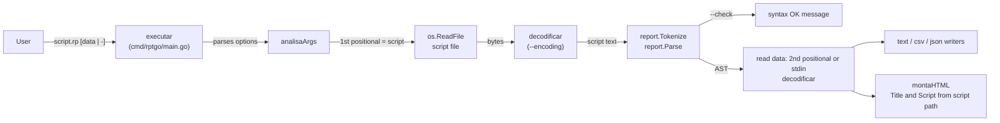
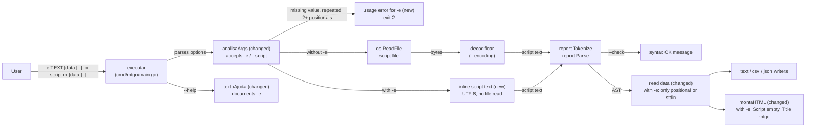

# SPEC: inline-script-option

## Metadata
- Source: developer description via /plan
- Service: rptgo (module `rptgo`, Go 1.25, stdlib only; verified at `go.mod`)
- Tier: standard
- Version: 1.0
- Architecture references: `AGENTS.md`, `docs/agents/architecture.md`, `docs/agents/domain_rules.md` (project rule: `.claude/rules/bc-harness.md`; also consulted: `docs/agents/coding_guidelines.md`, `docs/agents/api_contracts.md`)

## Context
`rptgo` reads the report script only from a file: the first positional argument is the script path and the second is the data file (verified at `cmd/rptgo/main.go:69-80`). A conversion that needs only a column list therefore requires a `.rp` file, or a shell construct such as `<(echo ...)` or `/dev/stdin`, which the conversion example documents as unavailable on Windows (`examples/conversao-formatos/README.md:173-195`). This feature adds `-e TEXT` / `--script TEXT` to pass the script text on the command line.

Applicable architecture rules:
- `cmd/rptgo` owns flags, exit codes, file and stdin I/O, encodings and output writers; script parsing belongs to `internal/report` (`docs/agents/architecture.md`, "Layer responsibilities").
- Option validation lives in `analisaArgs`; usage errors return 2, and script, data, I/O or template errors return 1 (`docs/agents/coding_guidelines.md`, section 3).
- Script defaults, input typing and output value rules stay as described in `docs/agents/domain_rules.md`; this feature changes none of them.

Codebase findings that affect the feature:
- Neither `-e` nor `--script` exists today; both fall into the unknown-option branch (verified at `cmd/rptgo/main.go:453-456`).
- The script file is decoded with `--encoding` (verified at `cmd/rptgo/main.go:85`); inline text must bypass that decoding (RF-06).
- `{{Script}}` and the default `{{Title}}` are derived from the script path (verified at `cmd/rptgo/html.go:237-245`), which does not exist for an inline script (RF-07).
- Script error context is taken from the script text registered before tokenizing (verified at `cmd/rptgo/main.go:86` and `internal/report/errors.go:27-42`).

Documentation language: `.claude/rules/bc-harness.md` asks for pt-BR docs to be translated when next touched. Keeping `README.md`, `examples/conversao-formatos/README.md` and the help text in pt-BR is a planning assumption, consistent with the previous change to those files, and not explicitly confirmed by the developer; translation stays out of scope.

## AS IS — Estado atual

The script always comes from a file named by the first positional argument and is decoded with the same `--encoding` as the data. The HTML writer derives `{{Script}}` and the default `{{Title}}` from that file name.

## TO BE — Estado proposto

`analisaArgs (changed)` realizes RF-01, RF-02 and CT-01; the new usage error realizes RF-03; the new inline script text realizes RF-01, RF-04, RF-05 and RF-06. The changed data read realizes RF-02, the changed `montaHTML` realizes RF-07, and the changed help realizes RF-09 (RF-08 is the unchanged file path).

## Scope
- **In**: the `-e TEXT` / `--script TEXT` option; positional argument handling when it is present; its usage and script errors; `--check` with it; UTF-8 handling of its text; HTML `{{Script}}` and `{{Title}}` when it is present; documentation in `--help`, `README.md` and `examples/conversao-formatos/README.md`.
- **Out**:
  - A `--columns` option.
  - Type inference.
  - Translating existing pt-BR docs; they stay pt-BR.
  - Forms other than `-e TEXT` and `--script TEXT` (no `--script=TEXT`, no attached `-eTEXT`).
  - Changes to the `.rp` language.
  - Changes to `SAIDA-HTML.md` and `REFERENCIA.md`.
  - Hand edits to `AGENTS.md` or `docs/agents/*`.

## RIGID (Non-Negotiable)

### Functional Requirements

- RF-01 [Event-driven]: When the CLI is invoked with `-e TEXT` or `--script TEXT`, the system shall use TEXT as the complete report script, read no script file, and produce the same output as a `.rp` file containing the same text, for `--format text`, `csv`, `json` and `html`.
  - AC: For each of the four formats, with the same data, options, environment variables and `RPT_NOW`, stdout and exit code of the `-e` run are byte-identical to those of the `.rp` file run. For `html`, the only permitted differences are the `{{Script}}` and default `{{Title}}` values defined in RF-07; with `--title` set and a template that does not use `{{Script}}`, the bytes are identical.
  - AC: `-e` and `--script` given the same TEXT produce byte-identical stdout and the same exit code.
  - AC: A multi-line TEXT behaves as the same multi-line file, including under `--strict`.
  - AC: When TEXT equals the path of an existing `.rp` file, TEXT is interpreted as script source and that file is not read.
  - AC: With `-o FILE`, the content of FILE is byte-identical between the `-e` run and the `.rp` file run, subject to the same `html` exception.

- RF-02 [State-driven]: While `-e` or `--script` is present, the system shall treat the single positional argument as the data file, and shall read the data from standard input when that argument is absent or is `-`.
  - AC: `-e TEXT data.txt` reads `data.txt`.
  - AC: `-e TEXT` and `-e TEXT -` read standard input and produce the same output as `-e TEXT data.txt` fed the same bytes.
  - AC: The positional argument is accepted both before and after the `-e TEXT` pair.
  - AC: A positional data file that does not exist, without `--check`, exits 1 with a message prefixed `rptgo: ` on stderr.

- RF-03 [Unwanted]: If `-e` or `--script` has no value, appears more than once (in either spelling or mixed), or is combined with two or more positional arguments, then the system shall report a usage error and exit with code 2.
  - AC: Each of these invocations exits 2: `-e` as the last argument; `--script` as the last argument; `-e A -e B`; `--script A --script B`; `-e A --script B`; `-e A -e A`; `-e A x y`; `-e A script.rp data.txt`.
  - AC: In every case stdout is empty, stderr starts with `rptgo: ` and contains `Tente 'rptgo --help' para mais informações.` (format verified at `cmd/rptgo/ajuda.go:624-627`), no data is read from standard input, and no `-o` file is created.
  - AC: The same invocations with `--check` added before the first `-e` / `--script` also exit 2.
  - "Without a value" means no argument follows the option, the existing definition for options that take a value (verified at `cmd/rptgo/main.go:300-306`).

- RF-04 [Unwanted]: If the inline script contains an error, then the system shall report it in the current script error format (`linha N:` message, source line, `^` marker) and exit with code 1.
  - AC: For a TEXT with an invalid statement on line 2, stderr is byte-identical to that of the `.rp` file with the same text, line numbers count from the first line of TEXT, the source line and `^` marker come from TEXT, and the exit code is 1.
  - AC: A script error raised during execution (after parsing) yields the same stderr and exit code as the `.rp` file run.
  - AC: `-e ""` yields the same stderr and exit code (1) as an empty `.rp` file.

- RF-05 [Event-driven]: When `--check` or `-r` (verified at `cmd/rptgo/main.go:451`) is combined with `-e` or `--script`, the system shall parse only the inline script and read no data.
  - AC: A valid TEXT prints `Script sem erros de sintaxe.` (verified at `cmd/rptgo/main.go:98`) followed by a newline on stdout and exits 0.
  - AC: An invalid TEXT produces the error of RF-04 and exits 1.
  - AC: With a nonexistent data file as the positional argument, a valid TEXT still exits 0.
  - AC: Without a positional argument, nothing is read from standard input.

- RF-06 [State-driven]: While `-e` or `--script` is present, the system shall take TEXT as UTF-8 whatever the value of `--encoding`, and shall keep applying `--encoding` to the data input and to the output.
  - AC: With `--encoding latin-1`, a TEXT containing the literal `São` passed as UTF-8 writes `ã` as the single byte `0xE3`; with `--encoding cp850`, as the single byte `0xC6`.
  - AC: With `--encoding latin-1` or `cp850`, latin-1 or cp850 data bytes are decoded as they are today, and the output is byte-identical to the run of a `.rp` file that holds the same characters saved in that encoding.
  - AC: With the default encoding, TEXT bytes are used as received, the same as the bytes of a UTF-8 `.rp` file.
  - AC: For `--format html`, the output stays UTF-8 as it is today.

- RF-07 [Conditional]: Where `--format html` is used with `-e` or `--script`, the system shall render `{{Script}}` as an empty string and shall use `rptgo` as the default `{{Title}}`, while `--title` shall still override the title.
  - AC: A template containing `[{{Script}}]` renders `[]`.
  - AC: Without `--title`, `{{Title}}` renders `rptgo`, including in the built-in template, and also when the binary is invoked under another file name.
  - AC: With `--title X`, `{{Title}}` renders `X`.

- RF-08 [State-driven]: While neither `-e` nor `--script` is present, the system shall keep the current behaviour.
  - AC: All tests that exist before this feature pass without changes to their expected values; the only expected output that changes is the `--help` text reproduced in the marked block of `README.md`.
  - AC: Invocation without any argument still exits 2 with stderr starting `rptgo: falta o arquivo de script` (verified at `cmd/rptgo/main.go:69-73`).
  - AC: With a script file, `{{Script}}` is the script file name and the default `{{Title}}` is the file name without extension.

- RF-09 [Ubiquitous]: The system shall document `-e` / `--script` in the `--help` output, in `README.md` and in `examples/conversao-formatos/README.md`.
  - AC: `--help` exits 0 and its stdout contains the option entry `-e, --script` and a statement that the inline text is UTF-8 and not affected by `--encoding`.
  - AC: `README.md` and `examples/conversao-formatos/README.md` each contain at least one command using `-e` or `--script` inside a block marked `<!-- run -->` and followed by its `<!-- expect -->` block (markers verified at `cmd/rptgo/readme_test.go:55-62`).
  - AC: No statement in those two files or in `--help` says that `--encoding` applies to the inline text, or that a script file is the only way to pass a script on Windows.
  - AC: `go test ./cmd/rptgo -run 'Readme|Ajuda'` exits 0.

### Contracts

- CT-01: CLI surface.
  - Existing form, unchanged: `rptgo [options] script.rp [data-file | -]`
  - New form: `rptgo [options] (-e TEXT | --script TEXT) [data-file | -]`
  - Options and the positional argument may appear in any order, as today (verified at `cmd/rptgo/main.go:293-297`).
  - `-h` / `--help` anywhere still prints help and exits 0 (verified at `cmd/rptgo/main.go:58-63`).

  | Exit | Meaning for the new form |
  |---|---|
  | 0 | Report produced, or `--check` found no syntax errors |
  | 1 | Script, data, I/O or template error |
  | 2 | `-e` / `--script` without value, repeated, or with 2+ positional arguments; other usage errors as today |

### Non-Functional Requirements

- RNF-01: The feature adds 0 external dependencies: `go.mod` has no `require` directive and no `go.sum` file exists.
- RNF-02: `go test ./...` exits 0 with 0 failing tests.
- RNF-03: 100% of new identifiers and code comments under `cmd/` and `internal/` are in pt-BR; new help text, error messages and additions to `README.md` and `examples/conversao-formatos/README.md` are in pt-BR.
- RNF-04: The implementation diff contains 0 hand edits to `AGENTS.md` and `docs/agents/*`.

## FLEXIBLE (Implementation Suggestions)
- Add a `case "-e", "--script"` to the switch in `analisaArgs` using the existing `next()` helper, which consumes the following argument whatever it starts with. Track presence with a flag separate from the text, so that `-e ""` counts as present.
- Branch in `executar` before `os.ReadFile`: with the inline flag set, skip both the read and `decodificar`, then reuse the same path from `report.DefFonteScript` onward.
- In `montaHTML`, branch on the inline flag. `filepath.Base("")` returns `.`, so an empty script path must not reach it.
- Keep the first usage line of the help unchanged (`cmd/rptgo/ajuda_test.go:14` checks it as a prefix); add a second usage line or an entry under "Opções".
- Word the new usage errors like the existing ones, for example `falta valor para -e` (already produced by `next()`), and add messages for the repeated option and for extra positional arguments.
- Extend the option list in `TestAjudaListaTodasAsOpcoes` with `-e, --script`.
- In the docs, replace or complement the `<(echo ...)` examples with `-e`. Marked commands cannot use pipes or process substitution, so pass a data file path (for example `examples/conversao-formatos/clientes.txt`). If the heading "Sem criar o arquivo `.rp`" is renamed, update the anchor link at the top of the example page.
- Mention in the docs that shell quoting applies to TEXT, for scripts that contain quotes such as `separator ';'`.
- After the code change, re-run `/bc-harness:ai-context` so the generated docs list the new option.

## Acceptance Criteria Summary
| ID | Criterion | Testable? |
|----|-----------|-----------|
| RF-01 | `-e` / `--script` output is byte-identical to the `.rp` file run in text, csv, json and html (html exception per RF-07) | Yes |
| RF-02 | The only positional is the data file; absent or `-` reads stdin | Yes |
| RF-03 | Missing value, repetition or 2+ positionals: usage error, exit 2 | Yes |
| RF-04 | Inline script errors keep line + caret format, exit 1 | Yes |
| RF-05 | `--check` works with `-e` and reads no data | Yes |
| RF-06 | TEXT is UTF-8; `--encoding` applies to data and output only | Yes |
| RF-07 | HTML: empty `{{Script}}`, default `{{Title}}` is `rptgo`, `--title` overrides | Yes |
| RF-08 | Behaviour without `-e` is unchanged | Yes |
| RF-09 | `--help` and both READMEs document `-e`; marked blocks verified | Yes |
| CT-01 | CLI forms and exit codes | Yes |
| RNF-01 | 0 external dependencies | Yes |
| RNF-02 | `go test ./...` exits 0 | Yes |
| RNF-03 | pt-BR identifiers, comments, user-facing strings and README additions | Yes (review) |
| RNF-04 | 0 hand edits to generated agent docs | Yes |
