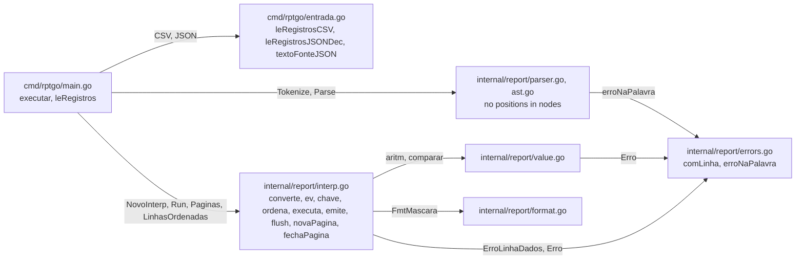
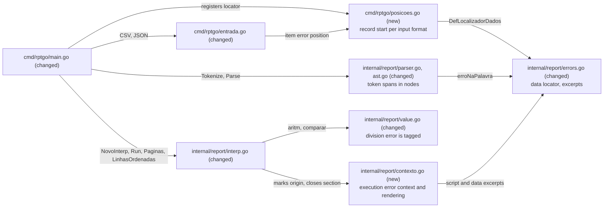

# Implementation Plan

## Request Summary
- Objective: report data errors on the record's real source line; stop on every division or modulo by zero (sections and sort keys); attach section, script and data context to execution errors; stop discarding `header` / `footer` errors; leave error-free runs unchanged (SPEC v1.1, RF-01 to RF-09, CT-01, CT-02).
- Scope: in: `cmd/rptgo` readers and CLI wiring, `internal/report` (parser positions, errors, evaluation, pagination), tests, `REFERENCIA.md`, `BACKLOG.md`. Out: rest of B4, B1, B2, B5 to B10, parse-time and setup errors, `min` / `max` comparison errors, footer height run semantics, new options, doc translation, hand edits to `AGENTS.md` and `docs/agents/*`.
- Tier: standard
- Architecture references: `AGENTS.md`, `docs/agents/architecture.md`, `docs/agents/domain_rules.md`, `docs/agents/coding_guidelines.md`, `.claude/rules/bc-harness.md`
- Baseline: commit `a3ae252`; `go test ./...` passes there (Go 1.25.5).
- Execution: one implementer, sequential.

## AS IS — Componentes impactados



Readers return only fields, `converte` uses the record number as the line number, AST nodes keep no script position, and `fechaPagina` / `novaPagina` drop the error returned by `exec`.

## TO BE — Componentes propostos



`errors.go` gains the data locator and excerpts (T02) and the reusable script excerpt (T04); `posicoes.go`, `main.go` and `entrada.go` come from T03; node positions from T04; `contexto.go`, `value.go` and the marking in `interp.go` from T05; error propagation through pagination in `interp.go` from T06.

## Design Decisions

These bind all tasks. Layering follows `docs/agents/architecture.md`: the CLI owns I/O, input formats and error printing; `report` owns script semantics and imports the standard library only; `report` never learns the input format.

1. **Record positions are lazy.** `report` receives a locator `func(registro int) PosicaoDados{Linha, Coluna}` (line 1-based; column in runes, 0-based) through a new `DefLocalizadorDados`, next to the existing globals `FonteScript` / `FonteDados`. `DefFonteDados` resets it to nil; nil means line = record number, column 0 (today's behaviour for library callers). The CLI locators re-scan the input only when an error is rendered, so readers keep their signatures and error-free runs pay nothing.
2. **Record number is recovered at error time.** The failing evaluation stores the `Row` it was reading (`it.row` at the point where the error is created). The number is found by comparing `&row[0]` against `it.rows`. When `sort` reorders rows, `ordena` keeps a parallel slice with the original numbers. `Row`, `converte` and the evaluation success path do not change.
3. **Script positions are token indices.** Nodes that can fail carry an unexported `pos {ini, foco, fim int32}`; `Script` keeps the token slice. Line, column and text are derived only when rendering. The zero value means "unknown" (token 0 is never part of an expression).
4. **Context is attached in two steps, rendered once.** The origin site marks position, row and (division) operand values; the innermost section boundary adds the section name. Rendering to text happens only for errors that will be reported, never for silently discarded sort key errors.
5. **Error layout** (the CLI adds the `rptgo: ` prefix; labels are required by CT-01, the rest is chosen here):

```text
divisão por zero na seção header
script, linha 4:
  4 | <script line or excerpt>
      <marker>
conta: 10 / z, com z = 0
dados, linha 5 (registro 4):
  5 | <data line or excerpt>
```

`conta:` appears only for division by zero. A sort comparison error has two `dados` parts. No marker under data lines in execution errors.

## Tasks

### T01 — Pin baseline behaviour
- **Files**: `cmd/rptgo/regressao_execucao_test.go` (new)
- **Change**: add table-driven tests through `executar` that pass unchanged on `a3ae252`, with exact stdout, stderr, exit code and, where relevant, `-o` content. Cases: (a) `header` and `footer` aggregates computing a value on a page break inside a running group (`after report` and `after <key>` long enough to break), text and html; (b) `sort d substr[1-2]` with `d` a date, formats text, csv, json, html; (c) divisions that are not evaluated: untaken `if` branch, short-circuited `and` / `or`, record excluded by `where`, section that does not run, all sections under csv and json; (d) a successful report with divisions, sort and page breaks under `--form-feed`, `--lines`, `--strict`; (e) short-line data errors for delimited input without header (invalid value, `phase error`), exact stderr; (f) date and time with `/` and `%`: substring of the invalid operation message only. Do not pin behaviour that RF-01 to RF-07 change. Capture expected values from the baseline binary.
- **Covers**: RF-08, RF-09, RF-02 (non-evaluated and non-numeric ACs), RNF-02
- **Tests**: `cmd/rptgo/regressao_execucao_test.go` — cases above
- **Risk**: Low — tests only
- **Dependencies**: none

### T02 — Data locator, data excerpt and real line in data errors (`report`)
- **Files**: `internal/report/errors.go`, `internal/report/interp.go` (`converte`, `tipa`), `cmd/rptgo/regressao_script_test.go`, `internal/report/erro_dados_test.go` (new)
- **Change**: add `PosicaoDados`, `DefLocalizadorDados` and an exported constructor for a data error at a given position (used by the CLI for JSON item errors). `ErroLinhaDados` keeps receiving the record number, resolves it through the locator and keeps that number in the message. Rendering, for a line measured in runes without the trailing `\r`: at most 72, exactly today's output (`comLinha`); more than 72, take at most 72 runes starting at the record column, `...` on each cut side (the left one sits before the excerpt), marker under the first character of the record with `max(1, min(40, runes in the excerpt))` carets, never under the trailing `...`. Provide the same excerpt without marker for the `dados` part of T05. `ErroLinhaScript` keeps using `comLinha` unchanged. Update only the two long-line expectations in `TestRegressaoErrosSemMudanca` ("valor invalido em linha longa", "campos demais").
- **Covers**: RF-01, CT-02
- **Tests**: `internal/report/erro_dados_test.go` — 72 vs 73 runes; cut at column 0 and mid-line; at most 72 remaining gives no trailing `...`; tabs and multibyte; CRLF; record near line end (short marker); nil locator; locator reset by `DefFonteDados`
- **Risk**: Medium — shared helper with script errors; keep `comLinha` behaviour intact
- **Dependencies**: T01

### T03 — Record start positions in the CLI
- **Files**: `cmd/rptgo/posicoes.go` (new), `cmd/rptgo/main.go`, `cmd/rptgo/entrada.go`, `cmd/rptgo/linhas_dados_test.go` (new)
- **Change**: one locator per input format, registered right after `DefFonteDados`.
  - Delimited: line = record number + skipped header lines (0 or 1), column 0.
  - CSV: build a new reader with the same settings as `leRegistrosCSV` (extract the constructor and the header-skip decision into helpers used by both), `Read` up to record N plus the skip, take the line from `FieldPos(0)`, column 0. This covers blank lines and multi-line quoted fields.
  - JSON: on error only, walk the BOM-trimmed text with `json.Decoder` (`Token` for `[`, `More`, `Decode` into `json.RawMessage`), count items across all top-level values with arrays expanded, and take the first non-blank, non-comma byte at or after `InputOffset` as the item start. Convert to line and rune column; add 1 to the column on line 1 when the raw text has a BOM.
  - `leRegistrosJSONDec`: the two item errors ("não é um objeto", "não é um valor simples") use the T02 constructor with the item position; keep their message text. The global index is `len(objs)` for the non-object item and `i` for the nested field. Other JSON and CSV errors stay as they are.
  - Remove `textoFonteJSON` and the second `DefFonteDados` call, so JSON lines are not shifted.
- **Covers**: RF-01, CT-02
- **Tests**: `cmd/rptgo/linhas_dados_test.go` — every RF-01 AC: header `auto` / `sim`; CSV blank lines, earlier and own multi-line field; JSON multi-line array, one object per line, leading blank lines, several top-level values; `phase error`; both JSON item errors, short and compact long line; stdin; utf-8, latin-1, cp850; CRLF; BOM; delimited without header byte-identical
- **Risk**: Medium — locator must agree with the reader; test line text for several record positions
- **Dependencies**: T02

### T04 — Script positions in the syntax tree and reusable script excerpt
- **Files**: `internal/report/ast.go`, `internal/report/parser.go`, `internal/report/errors.go`, `internal/report/posicoes_test.go` (new)
- **Change**: add the unexported `pos` to `ColExpr`, `CallExpr`, `SubstrExpr`, `CmpExpr`, `BinExpr` and `SortKey`, plus `posCol` / `posMascara` to `PrintItem`; keep the tokens in `Script`. Spans: for binary and comparison operations, `ini` is the token index taken before parsing the left operand (so left-associative chains and operand parentheses are included), `foco` the operator, `fim` the last token of the right operand; name, function and `substr` nodes mark only that token; column, mask and sort key spans cover the whole expression (the key span excludes `<name>`). `registraNome` must compare expressions ignoring positions (add `semPosicao`, a recursive copy with positions zeroed, then `reflect.DeepEqual`), including nested `Args`, `Where` and `X`. Extract the excerpt and marker logic of `erroNaPalavra` into a helper taking line, column, length and a focus column that must stay inside the 72-rune window: shorter spans are centred as today; spans of 72 or more start at the span unless the operator would fall outside, in which case the window is centred on the operator and the carets start at the excerpt start. `erroNaPalavra` passes focus = column, so its output does not change.
- **Covers**: RF-04 and RF-06 (position and excerpt groundwork), RF-08
- **Tests**: `internal/report/posicoes_test.go` — spans for `a / b, c / d`, `a / (b / c)`, `(a + 1) / z`, multi-line operation; identical named expressions on different lines still parse and different ones still fail; long-line window contains the operator. Existing `erro_script_test.go` and `nomeadas_test.go` pass unchanged
- **Risk**: Medium — a missed node in `semPosicao` rejects valid scripts
- **Dependencies**: T02 (same file `errors.go`)

### T05 — Execution error context, division by zero in sort keys
- **Files**: `internal/report/contexto.go` (new), `internal/report/errors.go`, `internal/report/value.go`, `internal/report/interp.go`, `REFERENCIA.md` (three error blocks), `internal/report/erro_execucao_test.go` (new)
- **Change**:
  - `Error` gains a division tag, `pos`, the read `Row`, operand values and section. `aritm` returns the tagged error at its four `divisão por zero` sites; date and time operations are untouched.
  - Mark at origin only (the first mark wins): `ColExpr` (unknown name, self-reference), `CallExpr` (`dow`, `mdy`, unknown function, aggregate outside a group), `SubstrExpr`, `CmpExpr`, `BinExpr` (keeping the two operand values before any bool conversion), and in `printStmt` the column expression and the mask expression. No work is added on the success path.
  - Section boundary: one method that runs a section body and completes the error with the section name only if it has none, used by the footer height run (`footer`), the first-page `header`, the `header` after `before report`, `roda` (`before report`, `before <key>`, `detail`, `after <key>`, `after report`) and later by T06.
  - Rendering (`contexto.go`): message + ` na seção <name>`; script part with the line of `foco` and carets over the span tokens on that line; for division, `conta:` with the operation rebuilt from the tokens (any gap or line break becomes one space), then `source = value` for each operand that is not a literal constant (a parenthesized operand is listed). Values in pt-BR: `nulo (conta como 0)`, `texto vazio (conta como 0)`, `texto "abc" (conta como 0)` (quoted on one line), booleans as `falso (conta como 0)` / `verdadeiro (conta como 1)`, numbers without exponent notation. Then the `dados` part with record number, locator line and T02 excerpt. Missing source text or position omits only that line or part.
  - `chave`: wrong type errors keep `no sort: ` before the current message; division errors are returned too; both get section `sort`. Every other error still leaves the key null and is never rendered (RF-09).
  - `ordena`: keep the parallel original-number slice; on the first comparison error keep the `no sort: ` message and render section `sort`, the key's span (carets from its first character) and both records, lower number first.
  - Update the verified `REFERENCIA.md` blocks for unknown name, division by zero and aggregate in `header` (about lines 1925, 1989, 2007) to the real output.
  - Errors raised outside evaluation (`não há registros de entrada`, `verificaEventos`) stay unchanged.
- **Covers**: RF-02, RF-03, RF-04, RF-05, RF-06, RF-09, CT-01
- **Tests**: `internal/report/erro_execucao_test.go` (set and restore the source globals) — one case per RF-06 table row; every RF-04 AC; RF-05 ACs for aggregate argument / `where`, aggregate operands, `before` / `after` sections, footer height run, sorted input; sort type error and sort comparison error (both directions); first failing record in input order. `falhas_test.go` passes unchanged
- **Risk**: High — touches every evaluation error path; success path performance
- **Dependencies**: T02, T04

### T06 — Propagate `header` and `footer` errors
- **Files**: `internal/report/interp.go`, `internal/report/erro_paginacao_test.go` (new)
- **Change**: `emite`, `flush`, `fechaPagina` and `novaPagina` return `error`; every caller (`exec` for `print`, `skip`, `page`, `need`; `printStmt`; the section boundary; `executa`) returns it at once, so nothing runs after the first error (no `header` after a failed `footer`). `footer` and `header` run through the T05 section boundary, so the innermost section is named. Do not change when or with which values any section is evaluated; aggregate state inherited on a page break stays as today.
- **Covers**: RF-07, RF-02, RF-03, RF-05
- **Tests**: `internal/report/erro_paginacao_test.go` — both B3 commands (record 5; line 6 with a skipped header, via locator); break forced by `page`, `need`, `skip` and a full body; unknown name in break `header`; `dow()` type error in closing `footer`; `if pageno > 1 then print total(n)`; one error when several sections would fail
- **Risk**: High — reports that succeed today with truncated lines now fail (intended)
- **Dependencies**: T05

### T07 — CLI acceptance matrix and performance check
- **Files**: `cmd/rptgo/erros_execucao_cli_test.go` (new)
- **Change**: end-to-end tests, then benchmarks of HEAD against `a3ae252` (temporary `git worktree` outside the repository, removed afterwards): `go test -run '^$' -bench Converte200k -benchmem -count=5 ./internal/report/` and `go test -run '^$' -bench 'Entrada|Relatorio' -benchmem -count=5 ./cmd/rptgo`. Guard: median ns/op within 10% and no per-record growth in allocs/op. Report the numbers in the task result; do not commit them. Fix any defect found in the owning file. Confirm `go.mod` has no `require` and no `go.sum` exists.
- **Covers**: RF-01 to RF-09, CT-01, CT-02, RNF-01, RNF-02
- **Tests**: `cmd/rptgo/erros_execucao_cli_test.go` — `/` and `%`, integer and float, in all nine RF-02 section positions; aggregate argument and `where`; sort key direct, named, first and later key, `desc`, four formats; B3 and B4 commands; empty stdout on page 2 errors (text, html) and sort errors (csv, json); `-o` not created and existing file unchanged; identical stderr for `.rp` and `-e`; data part for delimited, CSV and JSON including long lines; `--form-feed`, `--lines`, `--strict`; one silent key plus one dividing key
- **Risk**: Low — verification
- **Dependencies**: T03, T06

### T08 — Reference and backlog
- **Files**: `REFERENCIA.md`, `BACKLOG.md`; `README.md` only if a statement contradicts the SPEC
- **Change**: in pt-BR in `REFERENCIA.md`: section 5 table rows `header` and `footer` (they read the record current when they run; on a page break, the one that caused it); section 8.1 aggregate paragraph (in `header` / `footer` the error happens when no section with a group is running; on a page break inside one, that group is seen; errors are always reported); sections 4 and 7.2 (zero divisor, including null, empty and text, stops the report, also in sort keys); section 12 intro (data error line is the record's first physical line, long-line excerpt; execution error parts `script`, `conta`, `dados`; two records for sort comparison). Verify each new claim against the binary. Search both docs for other contradictions of RF-01 to RF-09. In `BACKLOG.md` (English): remove B3 (row and section); rewrite B4 without the division case, using `sort d substr[1-2]` as the example. Do not edit `AGENTS.md` or `docs/agents/*`.
- **Covers**: RNF-03, RNF-04, RNF-05
- **Tests**: `go test ./cmd/rptgo -run 'Readme|Referencia'`
- **Risk**: Low — documentation
- **Dependencies**: T06

## Execution Phases
| Phase | Tasks | Parallel-safe? |
|-------|-------|----------------|
| 1 | T01 | n/a (single task) |
| 2 | T02 | n/a (single task) |
| 3 | T03, T04 | Yes: `cmd/rptgo` vs `internal/report`, no shared file |
| 4 | T05 | n/a (single task) |
| 5 | T06 | n/a (single task) |
| 6 | T07, T08 | Yes: new test file vs documentation (rerun `go test ./...` if T07 fixes code) |

`go test ./...` must exit 0 at the end of every phase.

## Risks
| Risk | Blast radius | Mitigation | Rollback |
|------|-------------|------------|----------|
| Scripts that succeed today now exit 1 (`header` / `footer` errors, divisions in sort keys) | Users with latent errors | Intended by RF-02 and RF-07; T01 pins what must not change; examples and golden tests run each phase | Revert T06, or the `chave` change in T05 |
| Sort keys using `pageno` or a `set` variable as divisor fail: both are 0 or null while sorting | Reports sorted by such keys, all formats | Follows RF-02; covered by a T05 test; the error shows operand values | Same as above |
| Evaluation performance (larger nodes, error returns in pagination) | All reports | No success-path bookkeeping; lazy locators and rendering; benchmark guard in T07 | Revert T04 to T06 |
| Silent sort key errors become expensive if rendered or located | Large inputs with a failing key | Render only reported errors (design decision 4) | Revert T05 |
| Positions break named expression equality | Valid scripts rejected at parse and `--check` | `semPosicao` tests; existing `--check` regression | Revert T04 |
| Locator disagrees with the reader (CSV, JSON, header skip) | Wrong line in errors only | Shared reader constructor and header helper; per-format tests | Revert T03 (falls back to record number) |
| Excerpt refactor changes script error output | Parse errors | `erro_script_test.go` unchanged | Revert T04 |

Rollout: single binary, no migration or flag. After merge the developer re-runs `/bc-harness:ai-context` so `docs/agents/domain_rules.md` and `AGENTS.md` stop describing discarded errors (not an implementation task).

## Open Questions
- RF-04 lists only operands that are not literal constants, but also requires null or empty operands to say `conta como 0`. For `10 / null` or `10 / ''` the plan lists no operand, so the phrase is absent. If it must appear, literal null and empty operands need an exception in T05.
- RF-06 asks a sort key type error to show "the key's script line", while its table and RF-04 point at the failing construct. They differ only when the key uses a named expression declared elsewhere, or spans lines. The plan shows the failing construct's line; showing the key line instead changes one rendering branch in T05.
- When the marked operation is longer than 72 code points and the operator lies beyond the first 72, the excerpt cannot both start at the construct and contain the operator. The plan keeps the operator visible and starts the carets at the excerpt start.
- Keeping `README.md` and `REFERENCIA.md` in pt-BR conflicts with the translate-when-touched rule in `.claude/rules/bc-harness.md` (SPEC assumption, `BACKLOG.md` B9). T08 does not translate.

## Assumptions
- The SPEC's FLEXIBLE suggestion that readers return start lines is replaced by lazy locators; observable behaviour is the same and success-path cost is zero.
- "Operation as written" allows collapsing whitespace, comments and line breaks between tokens to one space.
- The error layout in design decision 5 is acceptable; CT-01 freezes only order and labels.
- The 10% benchmark guard in T07 is a planning threshold; the SPEC sets none.
- No contract file is emitted: CT-01 and CT-02 are stderr text (router instruction).
- No existing example or documented block depends on a discarded error [UNVERIFIED]; the test suite in T06 checks it.
- A UTF-8 BOM counts as one code point of line 1 when deciding whether a data line is long.
- Invalid UTF-8 bytes in a cut data line may print as U+FFFD [UNVERIFIED]; lines of at most 72 code points are printed untouched.
- `internal/report/interp.go` is already not `gofmt` clean (`BACKLOG.md` B10); whole-file reformatting stays out of scope.
