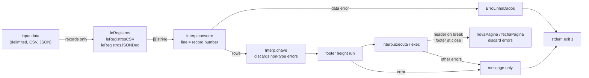
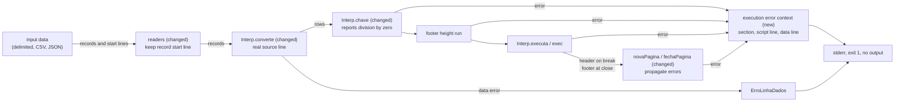

# SPEC: runtime-error-context

## Metadata
- Source: developer description via /plan
- Service: rptgo (module `rptgo`, Go 1.25, stdlib only; verified at `go.mod:1-3`)
- Tier: standard
- Version: 1.1
- Architecture references: `AGENTS.md`, `docs/agents/architecture.md`, `docs/agents/domain_rules.md`, `.claude/rules/bc-harness.md` (related: `BACKLOG.md` B3 and B4, `.spec/features/script-error-diagnostics/SPEC.md`)

## Context
Errors raised while `rptgo` runs a report are hard to locate, and some are lost. Behaviour reproduced on commit `a3ae252`:

- A data error uses the record number as the source line number (verified at `internal/report/interp.go:91-93`). With a skipped header the header line is shown for record 1. With a CSV field holding a line break, or with a blank CSV line, the shown line belongs to another place in the file. With JSON the shown line is not the line of the record, and with leading blank lines no source line is shown (the JSON source text is trimmed, verified at `cmd/rptgo/entrada.go:147`).
- A division by zero prints only `rptgo: divisão por zero` (verified at `internal/report/value.go:258-284`): no section, script line, operands or record.
- `header` errors on a page break and `footer` errors at page close are discarded (verified at `internal/report/interp.go:523` and `555`). The report ends with exit code 0 and truncated header or footer lines (`BACKLOG.md` B3).
- Sort key errors other than wrong value types are discarded and leave the key null, including division by zero (verified at `internal/report/interp.go:777-781`; `BACKLOG.md` B4).
- `header` and `footer` read the record that is current when they run, which on a page break is the record that caused the break. `REFERENCIA.md:553-554` says both see the first record. The data context required here follows the values actually read.
- The footer height is measured by running `footer` on the first sorted record before any other section runs (verified at `internal/report/interp.go:862-876`; `docs/agents/domain_rules.md`, "Pagination"). An error in that run already stops the report today.

Applicable architecture rules:
- The CLI owns file and stdin I/O, exit codes and error printing; the `report` package owns script semantics. Input adapters turn delimited, CSV or JSON input into records and do the header skip; typing by column belongs to the interpreter (`docs/agents/architecture.md`, "Layer responsibilities").
- Dependency direction: `cmd/rptgo` imports `internal/report`; `report` imports the standard library only (`docs/agents/architecture.md`).
- Exit codes: 0 ok; 1 script, data or I/O error; 2 invalid usage. Identifiers, comments, help text and error messages are pt-BR (`AGENTS.md`, section 2).
- Divide or modulo by 0 is the error `divisão por zero`; null counts as 0 in integer arithmetic and a string in arithmetic with numbers counts as 0 (`docs/agents/domain_rules.md`, "Arithmetic").
- `csv` and `json` output run no event section (`docs/agents/domain_rules.md`, "Output matrix").

Documentation language: `.claude/rules/bc-harness.md` asks for pt-BR docs to be translated when next touched. Keeping `README.md` and `REFERENCIA.md` in pt-BR is a planning assumption, not confirmed by the developer; translation stays out of scope.

Developer-approved items: the data source line, the division by zero stop with its context, the same context for other execution errors with header and footer errors no longer discarded, unchanged output for error-free runs, the excerpt of long data lines (RF-01) and the two records of a sort comparison error (RF-06). Statements marked "planning decision" below were not confirmed by the developer.

## AS IS — Estado atual



Readers drop source line positions, execution errors carry no script or data context, and header, footer and most sort key errors are lost.

## TO BE — Estado proposto



The changed readers and `Interp.converte` realize RF-01; the changed `Interp.chave` realizes RF-02 and RF-09; the changed `novaPagina` and `fechaPagina` realize RF-07 and RF-03; the new execution error context realizes RF-04, RF-05, RF-06 and CT-01.

## Scope
- **In**: source line of data errors; excerpt of long data lines in errors; stopping on division and modulo by zero in every section and in sort keys; section, script and data context for execution errors; operand values for division by zero; propagating `header` and `footer` errors; the `REFERENCIA.md` blocks and statements affected; updating `BACKLOG.md` (B3, and the division by zero part of B4).
- **Out**:
  - The rest of `BACKLOG.md` B4: other sort key errors silently ignored today stay silent.
  - `BACKLOG.md` B1, B2 and B5 to B10.
  - Errors raised before any record is evaluated: lexer and parser errors, static type and name checks, `before` / `after` of a nonexistent sort level, a variable named like an input column, `não há registros de entrada`. Their output stays as today.
  - Errors that are not discarded `header` / `footer` errors or sort key divisions and are ignored elsewhere today, such as comparison errors inside `min` and `max` (`internal/report/interp.go:412-413`) (planning decision).
  - Changing when or with which values the footer height run evaluates the footer (planning decision).
  - Message layout of data errors other than the source line, line number and, for long lines, the excerpt and marker of RF-01 (planning decision; `REFERENCIA.md:1843` treats data errors and execution errors as separate kinds).
  - Reporting more than one error per run; new command-line options; translating docs; hand edits to `AGENTS.md` or `docs/agents/*`.

## RIGID (Non-Negotiable)

Terms used below:
- **Execution error**: an error raised while evaluating a sort key or a section against records, including the footer height run.
- **Section**: `header`, `footer`, `detail`, `before report`, `before <key>`, `after <key>`, `after report` or `sort`. It is the innermost one running when the error is raised (a `header` run by a page break inside `detail` is `header`).
- **Record start line**: the 1-based physical line of the original input (file or stdin) on which the record begins.
- **Record number**: the 1-based position of the record in input order, not counting a skipped header, unaffected by `sort`.
- **Error-free run**: a run in which no evaluation raises an execution error that this spec requires to be reported, counting the `header` and `footer` evaluations whose errors are discarded today.

### Functional Requirements

- RF-01 [Event-driven]: When a data error is reported, the system shall show the record start line of the offending record (cut to an excerpt when long), with that line's number, and keep the record number in the message.
  - AC: Delimited and CSV input with a skipped header (`--header auto` and `--header sim`): an invalid value in record 1 reports and shows line 2, and the message says record 1.
  - AC: CSV input where an earlier record has a quoted field spanning 2 lines, or where blank lines precede the record: the reported number and shown text are those of the first physical line of the offending record.
  - AC: CSV input where the offending record itself spans several lines shows its first line, also when the invalid value is on a later line.
  - AC: JSON input as a multi-line array, as one object per line, and with leading blank lines: the reported line is the one holding the `{` that opens the offending object, and a source line is shown.
  - AC: The field count error (`phase error`) follows the same line rules.
  - AC: The JSON reader errors about one item (`campo ... não é um valor simples`, `o item N do array não é um objeto`, verified at `cmd/rptgo/entrada.go:88` and `130`) also show the line where that item starts (planning reading of the data error criterion).
  - AC: The line rules hold for stdin and for `--encoding utf-8`, `latin-1` and `cp850`, and with CRLF line endings.
  - AC: For delimited input without a header, when the offending line has at most 72 code points, stderr is byte-identical to the baseline.
  - AC: A data line of at most 72 code points, line terminator not counted, is printed with its marker as today, in every input format (planning decision).
  - AC: Any data line shown in an error (this requirement, including the field count and JSON item errors, and RF-05) that has more than 72 code points is cut to at most 72 code points of source, starting at the first character of the offending record, with `...` on each cut side, as for script errors.
  - AC: A long delimited line shows its first 72 code points followed by `...`. A compact JSON file longer than 72 code points shows an excerpt starting at the `{` of the offending object, preceded by `...`; when at most 72 code points remain on the line, no `...` follows.
  - AC: In a data error on a cut line, the `^` marker starts under the first character of the record, has at most 40 `^` and never extends past the last code point of the excerpt (the trailing `...` excluded) (planning decision).
  - AC: Marker alignment on cut lines holds with tabs and multibyte characters in the line (planning decision).
  - AC: The existing long-line expectations pinned at `cmd/rptgo/regressao_script_test.go:87-106` may change to the cut form; the short-line cases there keep their expected text (planning decision).

- RF-02 [Unwanted]: If the right operand of `/` or `%` evaluates to zero for arithmetic purposes (integer 0, float 0, null, empty string, any other text, false) in any section or sort key, then the system shall stop the report with the error `divisão por zero` and exit with code 1.
  - AC: A zero divisor in each of `detail`, `before report`, `before <key>`, `after <key>`, `after report`, `header` on page 1, `header` on a later page, `footer` on a page break and `footer` on the last page exits 1, for both `/` and `%`, with integer and float operands.
  - AC: A zero divisor inside the argument or the `where` condition of `count`, `total`, `avg`, `min` and `max` exits 1.
  - AC: A zero divisor in a sort key, directly or through a named expression, in the first or a later key, with or without `desc`, exits 1 with `--format text`, `html`, `csv` and `json`.
  - AC: Both commands of `BACKLOG.md` B3 (the `header` one and its `footer` variant) and the command of B4 exit 1.
  - AC: A division that is not evaluated raises no error: the untaken branch of an `if`, the right side of a short-circuited `and` / `or`, an argument of a record excluded by `where`, a section that does not run (including all sections with `csv` and `json` output).
  - AC: Operations that are not `/` or `%` on numbers keep today's result: date or time with `/` or `%` still reports its invalid operation error.

- RF-03 [Unwanted]: If an execution error occurs, then the system shall produce no report output, report only that first error, and exit with code 1.
  - AC: With an error on page 2 or later, stdout is empty for `--format text` and `html`.
  - AC: With a sort key error, stdout is empty for `--format csv` and `json`.
  - AC: With `-o FILE`, a nonexistent file is not created and an existing file keeps its content byte for byte.
  - AC: With several failing records or sections, stderr holds exactly one error, the first in execution order; for sort keys, the first failing record in input order.

- RF-04 [Event-driven]: When a division by zero is reported, the system shall name the section, show the script line of the operation with a `^` marker under the operation, and show the operation as written with the values of its operands.
  - AC: stderr names the section from the list in Terms; `before <key>` and `after <key>` include the key name; a sort key error names `sort`.
  - AC: The script line number and text are those where the failing `/` or `%` is written. For an operation inside a named expression, it is the declaration whose expression was evaluated, even when the running section is another one.
  - AC: With two divisions on one line (`print a / b, c / d`) and nested ones (`a / (b / c)`), the marker covers only the failing operation, from the first character of its left operand to the last of its right operand, parentheses of the operands included.
  - AC: For an operation written across several lines, the line holding the failing operator is shown and the marker covers the part of the operation on that line, including the operator.
  - AC: Script lines longer than 72 code points are shown as an excerpt of at most 72 code points that contains the failing operator, with `...` on each cut side; marker alignment holds with tabs and multibyte characters, as for script errors (verified at `internal/report/errors.go:68-110`).
  - AC: The operation text is shown, followed by the source text and evaluated value of each operand that is not a literal constant. `print 10 / z` with `z` = 0 shows `10 / z` and `z = 0`; `print 1 / 0` shows the operation with no operand list.
  - AC: An operand that is a column, variable, named expression, parenthesized expression, function call or aggregate shows the value it had in the failing evaluation.
  - AC: An operand that is null or an empty string is described as empty or null and stderr contains `conta como 0`.
  - AC: A text operand that is not empty shows its text and says that it counts as 0 (planning decision).
  - AC: The same script gives byte-identical stderr from a `.rp` file and from `-e`.

- RF-05 [Event-driven]: When a division by zero is reported, the system shall show the record start line, that line's text and the record number of the record whose values the failing evaluation read, labelled as data and separate from the part labelled as script.
  - AC: The output has a part labelled `script` with the script line number and a part labelled `dados` with the data line number and the record number.
  - AC: Inside an aggregate argument or `where`, the record shown is the group record being evaluated, not the record of the section.
  - AC: For a division whose operands are aggregate results (`total(a) / total(z)`), the record shown is the one the section reads (planning decision).
  - AC: In `header` and `footer` on a page break, the record shown is the one whose values were read. For the B3 `header` command and its `footer` variant it is record 5, line 5; with a skipped header line added to the data it is record 5, line 6.
  - AC: In `before <key>` it is the record opening the group; in `after <key>` and `after report`, outside aggregates, the last record of the group.
  - AC: In the footer height run it is the first sorted record, with its original line and record number, and the section is `footer`; operand values are those of that run.
  - AC: With `sort` reordering records, line and record number are still those of the input.
  - AC: The line rules of RF-01, including the excerpt of long data lines, hold for delimited, CSV and JSON input.

- RF-06 [Event-driven]: When any other execution error is reported, the system shall keep its current message text and add the section, the script line with a `^` marker under the construct that failed, and the data line and record number.

  | Execution error (call sites in `internal/report/interp.go`, `value.go`, `format.go`) | Marked construct |
  |---|---|
  | `nome desconhecido`, self-referencing named expression | the name |
  | `dow()` / `mdy()` type error, unknown function, aggregate outside a group | the function name |
  | `substr só pode ser usado com texto` | the `substr` keyword |
  | comparison type errors (date with number, time with another type) | the comparison operation |
  | `/+` on non-text, invalid date operation, invalid time operation | the operation |
  | `número de coluna inválido` | the column expression |
  | invalid text mask, invalid format mask | the mask expression |

  - AC: For each table row, a test shows the section, the script line number and text, the first `^` under the first character of the marked construct, and the data line and record number.
  - AC: The script and data parts follow the labels, excerpt, alignment and record rules of RF-04 and RF-05; operand values are required only for division by zero.
  - AC: A sort key type error keeps the substring `no sort: ` followed by the current message and shows the key's script line and the record being evaluated.
  - AC: The existing substring checks of `internal/report/falhas_test.go:37-45` still pass.
  - AC: A sort comparison error (two key values that cannot be compared, for example a date against a number, verified at `internal/report/interp.go:812-853`) keeps the substring `no sort: ` followed by the current message and shows the section `sort`, the script line of the key being compared and both records involved, each with its data line and record number.
  - AC: The two records of a sort comparison error are listed in input order (lower record number first), whatever the sort direction (planning decision); their data lines follow the line and excerpt rules of RF-01.
  - AC: In a sort comparison error the `^` marker starts under the first character of the key expression (planning decision).

- RF-07 [Unwanted]: If any execution error occurs in `header` or `footer`, on any page, then the system shall report it as in RF-04 to RF-06 and stop the report.
  - AC: A page-break `header` with an unknown name, and a `footer` at page close with a `dow()` type error, each exit 1.
  - AC: A `footer` of the form `if pageno > 1 then print total(n)`, which today exits 0 and loses the line on the last page, exits 1 with the aggregate error.
  - AC: A page break forced by `page`, `need`, `skip` or a full body propagates `header` and `footer` errors the same way.
  - AC: Behaviour is the same with `--format text` and `html`, and with `--form-feed`, `--lines` and `--strict`.

- RF-08 [State-driven]: While a run is error-free, the system shall produce the same stdout, output file, stderr and exit code as the baseline.
  - AC: All golden baselines and all `<!-- expect -->` and `<!-- output -->` blocks pass with unchanged expected text.
  - AC: Aggregates in `header` and `footer` that compute a value on a page break inside a running group today still produce that output.
  - AC: `--check` gives the same result as the baseline for every script.
  - AC: The long data line excerpt of RF-01 appears only in runs with an error and is outside this requirement; for data lines in errors, output identical to the baseline is expected only for lines of at most 72 code points (planning decision).

- RF-09 [State-driven]: While a sort key evaluation fails with an error that is neither a division by zero nor a wrong value type, the system shall keep leaving that key null without any message.
  - AC: `sort d substr[1-2]` with `d` a date column exits 0 with the same output as the baseline.
  - AC: With one key failing silently and another key of the same `sort` dividing by zero, the run exits 1 with the division error.

### Contracts

- CT-01: Execution error on stderr, exit code 1. Elements in this order: the message with the section; the `script` part (line number, source line or excerpt, `^` marker); for division by zero, the operation and operand values; the `dados` part (line number, record number, source line or excerpt per RF-01). A sort comparison error shows the data line number, record number and source line of two records, in input order. Illustration discussed with the developer; indentation and punctuation beyond the labels are not frozen:

  ```text
  rptgo: divisão por zero na seção header
  script, linha 4:
    <source line with ^ marker under the operation>
  conta: 10 / z, com z = 0
  dados, linha 5 (registro 4):
    4|0
  ```

- CT-02: Data error on stderr, exit code 1: current shape (message, `  N | <line>`, marker; verified at `internal/report/errors.go:27-42` and `113-116`), with `N` and `<line>` taken from the record start line. A line of more than 72 code points is shown as the excerpt and marker of RF-01.

### Non-Functional Requirements

- RNF-01: 0 external dependencies: `go.mod` has no `require` directive and no `go.sum` file exists.
- RNF-02: `go test ./...` exits 0 with 0 failing tests; changes to existing expected values are limited to the error output required by RF-01 to RF-07, including the long data line excerpt of RF-01.
- RNF-03: 100% of new identifiers, code comments and user-facing strings are in pt-BR; changes to `README.md` and `REFERENCIA.md` are in pt-BR (planning assumption for the two docs, see Context).
- RNF-04: Every marked block in `README.md`, `REFERENCIA.md`, `SAIDA-HTML.md` and `examples/*/README.md` matches the real output (`go test ./cmd/rptgo -run 'Readme|Referencia'` exits 0), and 0 statements in `README.md` or `REFERENCIA.md` contradict RF-01 to RF-09.
- RNF-05: 0 hand edits to `AGENTS.md` and `docs/agents/*`.

## FLEXIBLE (Implementation Suggestions)
- Have each reader return the start line of every record next to the fields: the line index in `leRegistros` (kept across the header skip), `csv.Reader.FieldPos` for CSV, and `json.Decoder.InputOffset` converted to a line number for JSON, computed on the untrimmed text so that `textoFonteJSON` can stop shifting lines.
- Keep the line and record number with each row so that sorting does not lose them.
- Record token ranges for expressions during parsing. A side table, or position fields excluded from the `reflect.DeepEqual` comparison in `registraNome`, keeps repeated identical named expressions valid.
- Attach the context where the error leaves the innermost node that has a position, and add section and record once, at the section boundary.
- Reuse the excerpt and marker logic of `erroNaPalavra`.
- Let `emite`, `novaPagina` and `fechaPagina` return or store the first error and stop execution.
- `REFERENCIA.md` places to review: the division by zero, unknown name and aggregate error blocks in section 12, the data error blocks, the record table in section 5 (`header` and `footer` rows) and the aggregate paragraph in section 8.1.
- After the code change, re-run `/bc-harness:ai-context` so `docs/agents/domain_rules.md` stops describing discarded errors.

## Acceptance Criteria Summary
| ID | Criterion | Testable? |
|----|-----------|-----------|
| RF-01 | Data errors show the record start line for delimited, CSV and JSON input, long lines cut to an excerpt | Yes |
| RF-02 | Zero divisor stops the run with exit 1 in every section and sort key, aggregates included | Yes |
| RF-03 | No partial output; one error | Yes |
| RF-04 | Division error shows section, script line with marker, operation and operand values | Yes |
| RF-05 | Division error shows the data line and record number actually read | Yes |
| RF-06 | Other execution errors carry section, script and data context; sort comparison errors show both records | Yes |
| RF-07 | `header` and `footer` errors are reported on every page | Yes |
| RF-08 | Error-free runs unchanged | Yes |
| RF-09 | Other silent sort key errors stay silent | Yes |
| CT-01 | Execution error shape | Yes |
| CT-02 | Data error shape with corrected line | Yes |
| RNF-01 | 0 external dependencies | Yes |
| RNF-02 | `go test ./...` exits 0 | Yes |
| RNF-03 | pt-BR identifiers, comments, strings and doc changes | Yes (review) |
| RNF-04 | Marked doc blocks verified | Yes |
| RNF-05 | 0 hand edits to generated agent docs | Yes |
