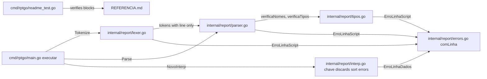
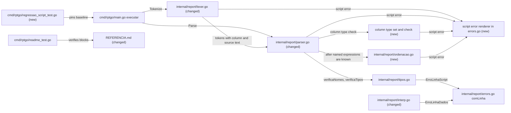

# Implementation Plan

## Request Summary
- Objective: make script mistakes loud and easy to locate, in `.rp` files and `-e` text: reject unknown column types (RF-01) and bad `sort` references (RF-02), put the marker under the offending word with a 72 code point window (RF-03, RF-04, RF-05), and say what was found for missing `end`, invalid expression and a stray comma in `input` (RF-06). Valid scripts and data errors stay unchanged (RF-07, RF-08).
- Scope: in = `internal/report` (lexer, parser, error rendering, new sort name check), tests in `internal/report` and `cmd/rptgo`, affected blocks and statements in `REFERENCIA.md` / `README.md`. Out = data errors, execution errors, static type check output from `tipos.go`, errors printed without a source line today, new options, translation of pt-BR docs, hand edits to `AGENTS.md` / `docs/agents/*`.
- Tier: standard
- Architecture references: `AGENTS.md`, `docs/agents/architecture.md`, `docs/agents/domain_rules.md`, `docs/agents/coding_guidelines.md`, `.claude/rules/bc-harness.md`
- Baseline: the working tree, including the uncommitted `-e` / `--script` feature. One implementer, sequential execution.

Layering rules that apply to every task: script syntax and the new script errors belong to `internal/report` (lexer/parser/ast); `cmd/rptgo` does not parse scripts and needs no production change (`docs/agents/architecture.md`, "Layer responsibilities"). Standard library only. Identifiers, comments and user-facing strings in pt-BR (`docs/agents/coding_guidelines.md`, RNF-03).

## AS IS — Componentes impactados

One routine, `comLinha`, draws the marker from column 1 for both script and data errors; tokens carry no column, and unknown column types and sort names pass `Parse`.

## TO BE — Componentes propostos

Lexer positions and the new renderer come from T02, parser positions, messages and the comma hint from T03, the column type check from T04, the sort name check and the `interp.go` comment from T05, `REFERENCIA.md` from T03 and T06, and the baseline tests from T01. `comLinha`, `ErroLinhaScript` (static type check) and `ErroLinhaDados` keep their behaviour.

## Tasks

### T01 — Pin baseline behaviour with characterization tests
- **Files**: `cmd/rptgo/regressao_script_test.go` (new)
- **Change**: before any production change, add tests that pass on the unchanged working tree, with literal expected values captured from it:
  1. `--check` on every `examples/*/*.rp` and `internal/report/testdata/golden/*.rp` exits 0 with stdout exactly `Script sem erros de sintaxe.\n`.
  2. Keyword-named columns (`date`, `end`, `sort`, `detail`, `width` and others), including a last column that follows a comma: exact stdout, `-o` content, empty stderr, exit 0, and `--check`.
  3. Valid `sort` keys with exact output: a column; `<mes> mdy(data, 0)`; a key naming an expression declared later in a `print`; a key naming a `set` variable with its `before` / `after`; `<g> g`; keys using `today`, `hour`, `pageno`, `null`, `dow`, `mdy`, `index`, `substr`; an aggregate in a `print` named expression that no key refers to.
  4. Data errors (invalid value and field count) on a data line longer than 72 code points, an indented one and one holding tabs: byte-identical stderr (whole line, marker from column 1, capped at 40).
  5. Static type check error (arithmetic `if` condition): byte-identical stderr.
- **Covers**: RF-07, RF-08, RNF-02
- **Tests**: `cmd/rptgo/regressao_script_test.go` — the five groups above
- **Risk**: Low — test-only; it is the guard for all later tasks
- **Dependencies**: none

### T02 — Token positions, script error renderer and lexer errors
- **Files**: `internal/report/lexer.go`, `internal/report/errors.go`, `internal/report/erro_script_test.go` (new)
- **Change**:
  - `Token` gains the 0-based column in code points within its line and the source text as written (quotes and original case included); every token kind fills both. `Text` stays as today (lower-cased identifiers, decoded strings). The lexer tracks the line start wherever it counts a newline, including inside multi-line comments; newlines consumed by a backslash escape in a string or by `N[<newline>]` must also advance line and line start.
  - Add a separate script error renderer in `errors.go` taking line, column, length and message. Do not modify `comLinha`, `ErroLinhaScript` (still used by `tipos.go`) or `ErroLinhaDados`.
  - Shape (CT-01): `linha N: msg`, then `  N | excerpt`, then padding as wide as `  N | ` followed by one pad per printed code point before the word (tab where the printed line has a tab, space otherwise, 3 spaces for a left `...`) and the `^` run.
  - Strip one trailing `\r` from the line before measuring and printing. A line outside the source (library use without `DefFonteScript`) yields the message only.
  - Window (RF-04), `n` = line length, `t` = word length, `c` = word column, all in code points. If `n <= 72`, print whole. Otherwise `start = c - max(0, 72-t)/2`, clamped to `[0, n-72]` when `t < 72` (with `t >= 72`, `start = c`); `end = min(start+72, n)`. Add `...` on each cut side. Caret count = `max(1, min(t, end-c))`.
  - Lexer errors use the renderer: unrecognized character (that character); both unterminated string errors (opening quote to last non-blank of the opening line); both comment errors (`/*` to last non-blank of the opening line). Capture the opening line and column before scanning. Messages are unchanged.
- **Covers**: RF-03 (lexer rows), RF-04, RF-05, RF-08, CT-01, RNF-01, RNF-03
- **Tests**: `internal/report/erro_script_test.go` — table by lexer row with preceding text and indentation; word near start, middle and end of a long line; word longer than the window; exactly 72 and 73 code points; CRLF; tabs; multibyte before the word, also on cut lines. Tests call `DefFonteScript` and restore it with `t.Cleanup`.
- **Risk**: Medium — off-by-one in positions and window; shared file with data errors
- **Dependencies**: T01

### T03 — Parser errors point at the offending word; missing `end`, invalid expression and comma hint
- **Files**: `internal/report/parser.go`, `internal/report/erro_script_test.go`, `cmd/rptgo/erros_script_cli_test.go` (new), `REFERENCIA.md` (repeated section error block only)
- **Change**:
  - Route every parser error through one helper that receives the **token index**. Capture the index before calling `nx()`. If the token at that index is EOF, report the last real token (its line, column, length). If the script has no real token, return `linha N: <message>` with no source line (N as today).
  - Fix each site to the RF-03 table: `apelido` (bad name); `numInt` (consumed token); `pInput` "nome de coluna" (the consumed token, not the next); `pEvento` "nome da seção" (the target) and repeated section (the repeated section keyword); `page` "'footer' ou 'header' esperado" (the consumed word); `set` "nome de variável" (the consumed token); `registraNome` (the name between `<` and `>`); `substrEspec` (the non-integer bound; for an invalid range the `substr` keyword); time and date literals (the literal; wrap the `ParseData` error, which has no line today); `kw`, `op`, main loop, `stmt`, `ePrim` (the found token).
  - Messages (RF-06), quoting source text as written (a string literal keeps its own quotes, other words are wrapped in `'...'`):
    - `falta o 'end' que termina o script: chegou ao fim do script depois de 'X'`; with no real token, `...: o script não tem nenhuma palavra`.
    - `falta 'end' do bloco 'begin' aberto na linha B: chegou ao fim do script depois de 'X'` (B = innermost unclosed `begin`; the `linha N:` prefix and source line follow the last word, per RF-03).
    - `expressão inválida: encontrado 'X'`, or `expressão inválida: chegou ao fim do script depois de 'X'`.
    - Other messages are unchanged.
  - **Extra comma hint — exact trigger.** All must hold: (a) `pInput` took as column name an identifier that came right after a `,`; (b) that identifier is a word that can start the next top-level instruction: `input`, `width`, `length`, `top`, `bottom`, `left`, `separator`, `sort`, `before`, `after`, `header`, `footer`, `detail`, `end`; (c) the parser error is raised **on the token immediately after that identifier** (index + 1; EOF counts, compared before the EOF fallback). Then append `; 'X' foi lido como nome de coluna do input; pode haver uma vírgula sobrando` to whatever message results. No hint in any other case: keyword followed by `[`, `sorted` or `,` (the error can no longer be at index + 1), non-instruction words such as `date`, `name`, `type`, any error further on, lexer errors, errors outside the parser. Store only the last such index in the parser struct.
  - Accepted scripts do not change: no new rejection in this task.
  - Update the `REFERENCIA.md` repeated-`detail` block (about lines 1958-1963) to line 4, `  4 | detail`, `^^^^^^`, so tests stay green at the end of this phase.
- **Covers**: RF-03, RF-05, RF-06, RF-07, CT-01, RNF-03, RNF-04
- **Tests**:
  - `internal/report/erro_script_test.go` — one case per parser row with preceding text; rejected word last on its line for `nome de coluna`, `nome da seção`, `nome de variável`, `'footer' ou 'header'`; `detail` on lines 2 and 4; scripts ending in newlines, blank lines and comments; empty and comment-only scripts; `print a, ,`; nested `begin`.
  - Hint positive: `input a,\nend`; `input a, end`; `input a,\nsort a\nend`; same with `width 80`, `left margin 0`, `before report`, `detail` + `print a`, each asserting the hint, line and marker.
  - Hint negative: `input a, width\ndetail\n print a +\nend` (unrelated later error); `input a, date\ndetail\n print date +\nend`; `input a, detail [numeric]\nbanana`; `input end` (no comma); keyword column followed by a lexer error.
  - `cmd/rptgo/erros_script_cli_test.go` — byte-identical stderr for `.rp` and `-e`, exit 1, empty stdout; alignment with `--encoding utf-8`, `latin-1`, `cp850` including a cut line with tabs and accents.
- **Risk**: Medium — many error sites; a wrong index marks the wrong word
- **Dependencies**: T02

### T04 — Reject unknown column types
- **Files**: `internal/report/parser.go`, `internal/report/interp.go` (only if the type set is placed next to `tiposInt` / `tiposFlt`), `internal/report/erro_script_test.go`, `cmd/rptgo/erros_script_cli_test.go`
- **Change**: keep one ordered list of the 15 valid types in `internal/report` (`string text numeric integer long int float amount double real huge date ldate time bool`) and derive both the lookup and the message from it. In `pInput`, right after consuming `[`, check the next token's `Text` against the set before reading size and `]`. Message: `tipo desconhecido 'X' na coluna 'C'; tipos válidos: <the 15, comma separated>`, X as written, marker under X; at end of script, say that the end was reached (still naming C and the list) and mark the last word. `[10]` and `[]` are rejected the same way. The check is on `Text`, so identifiers stay case-insensitive and a quoted `'numeric'` keeps working as on the baseline. Columns without `[...]` stay `string`. `cmd/rptgo/entrada.go` (`tiposNumericos`) is not changed.
- **Covers**: RF-01, RF-03, RF-07, CT-01, RNF-03
- **Tests**: `internal/report/erro_script_test.go` — `valor [numerc]` (all 15 names, marker), `[10]`, `[]`, EOF after `[`, each valid type lower and upper case with and without size, no `[...]`, every key of `tiposInt` / `tiposFlt` in the list; `cmd/rptgo/erros_script_cli_test.go` — same stderr and exit 1 with `--check` and `-r`, no OK message, nonexistent data file, stdin not read
- **Risk**: Medium — scripts that ran before (type silently read as text) now fail, as intended
- **Dependencies**: T03

### T05 — Reject unknown names, unknown functions and aggregates in `sort`
- **Files**: `internal/report/ordenacao.go` (new), `internal/report/parser.go`, `internal/report/interp.go` (comment in `chave` only), `internal/report/tipos.go` (comment in `tipoDeV` only, if inaccurate), `internal/report/erro_script_test.go`, `cmd/rptgo/erros_script_cli_test.go`
- **Change**:
  - Record references in a parser side table, not in the AST (`registraNome` uses `reflect.DeepEqual`): in `ePrim`, append each column reference and each function call (name, call flag, token index) in source order; `null`, `today`, `hour`, `pageno` without `(` are not recorded. Each sort key and each registered named expression keeps its slice range (first registration wins; the trivial `<g> g` registers nothing).
  - In `Parse`, after the `input` presence check, `coletarVariaveis` and `s.Nomeadas`, and before `verificaNomes` / `verificaTipos`, check the sort keys in order. For each reference: a call must be `dow`, `mdy` or `index`; `count total avg min max` give `agregados não podem ser usados no sort: 'f'`; any other function gives `função desconhecida no sort: 'f'`. A column reference is valid if it is an input column or a `set` variable (checked in that order, matching `Interp.ev`); else if it is a named expression, check that expression's references; else `nome desconhecido no sort: 'n'`. Expand each named expression once (visited set), which also stops self-references; their runtime behaviour is unchanged.
  - The error marks the token where the name is written, including inside a `print` named expression. `substr` is an operator and needs no rule; arguments and `where` clauses are covered by the side table.
  - Evaluation in `interp.go` is not changed; re-word the comment in `chave` so it does not claim more than the check guarantees.
- **Covers**: RF-02, RF-03, RF-07, CT-01, RNF-03
- **Tests**: `internal/report/erro_script_test.go` — `sort idades`; nested, `desc`, second key, function argument, via named expression (`sort k` with `print <k> zz`); `sort <x> x`; `foo(a)`; the five aggregates including `count(*)`, direct and through a named expression; chained and self-referencing names; all valid forms accepted. `cmd/rptgo/erros_script_cli_test.go` — same stderr and exit 1 with `--check` / `-r`; nonexistent data file, stdin unread and no `-o` file for `--format text|csv|json|html`
- **Risk**: High — a missed valid name form would reject working scripts; the error was silently ignored until now
- **Dependencies**: T04

### T06 — Reference documentation and final verification
- **Files**: `REFERENCIA.md`, `README.md` (only if a statement contradicts RF-01 to RF-06)
- **Change**: in pt-BR: section 3 states that a type outside the list is an error; section 4 states that unknown names, unknown functions and aggregates in `sort` are errors before data is read; section 12 gains one verified `<!-- script -->` + `<!-- data -->` + `<!-- error -->` example for each of the two new errors and describes the marker under the word, the 72 character excerpt and the extra comma hint. Re-read the section 12 introduction and the "Outros erros frequentes" sentence, and grep both files for statements about types, `sort` and errors. Do not edit the data error blocks (about lines 1875-1903). Do not translate existing text or edit `AGENTS.md` / `docs/agents/*`. Finish with the whole-feature checks.
- **Covers**: RF-08, RNF-01, RNF-02, RNF-03, RNF-04, RNF-05
- **Tests**: `cmd/rptgo/readme_test.go` — `TestReferenciaExemplos`, `TestReadmeBlocosConferem`; full `go test ./...`
- **Risk**: Low — docs only, verified by tests
- **Dependencies**: T05

## Execution Phases
| Phase | Tasks | Parallel-safe? |
|-------|-------|----------------|
| 1 | T01 | No — must run on the unchanged baseline |
| 2 | T02 | No — positions and renderer are required by T03 |
| 3 | T03 | No — shares `parser.go` and test files with T04, T05 |
| 4 | T04 | No — shares `parser.go` and test files |
| 5 | T05 | No — shares `parser.go` and test files |
| 6 | T06 | No — documents the final output |

## Risks
| Risk | Blast radius | Mitigation | Rollback |
|------|-------------|------------|----------|
| The sort check rejects a script that is valid today | Any user script with `sort`; all output formats | Same resolution order as `Interp.ev`; T01 pins every valid form; `--check` over examples and golden scripts | Revert T05 (new file plus side table) |
| Scripts with a misspelled type or sort name that ran silently now exit 1 | Existing user scripts relying on the silent behaviour | Intended by RF-01 / RF-02; message names the word and, for types, lists valid ones; mention in release notes | Revert T04 / T05 |
| Data error or type check output changes through shared error code | Every data error | Separate renderer; `comLinha` untouched; T01 byte-level tests | Revert T02 |
| Wrong position (multi-line comments, multibyte, CRLF, EOF) | All script errors | Table tests per RF-03 row, RF-04 and RF-05 | Revert T02 / T03 |
| Extra comma hint misleads | Message text only | Three-part trigger; negative tests. Residual: an intentional last column named like an instruction, with the error on the very next word, still gets the "may be" hint | Remove the hint append in the parser helper |
| Rollback by discarding the working tree destroys the uncommitted `-e` feature | `cmd/rptgo` changes and `script_texto_test.go` | Commit the `-e` baseline before Phase 1 (developer decision); revert per phase afterwards | Restore from the baseline commit |

## Open Questions
- Documentation language: `.claude/rules/bc-harness.md` says existing pt-BR docs are translated to English when next touched; SPEC Scope puts translation out and RNF-03 asks for pt-BR additions to `README.md` / `REFERENCIA.md` (marked there as unconfirmed). This plan follows the SPEC, because translating both files is a large separate change that the SPEC excludes. Confirm, or schedule the translation as its own feature.
- Missing block `end`: RF-03 puts the marker on the last word of the script, while RF-06 asks for the line number of the unclosed `begin`. The plan satisfies both by keeping the `linha N:` prefix on the last word and naming the `begin` line inside the message. If the prefix itself should be the `begin` line, T03 changes.
- Outside scope, observed in code: other evaluation errors in sort keys (for example division by zero) are still discarded by `Interp.chave`, and `dow` / `mdy` / `index` index `args` without an arity check (`internal/report/interp.go:429-456`), so a wrong argument count can panic at run time. Worth a follow-up feature?

## Assumptions
- The hint word list is narrower than "any keyword": only words that can start the next instruction can have been swallowed by a stray comma. This covers every example in RF-06.
- A quoted valid type (`['numeric']`) works today and stays accepted; `['Numeric']` is rejected.
- Counting newlines consumed by a string escape or by `N[<newline>]` only corrects line numbers in those pathological scripts and changes no acceptance. [UNVERIFIED: no test or example uses either form]
- `where` inside a non-aggregate function in a sort key is checked like any other reference, although the interpreter ignores it.
- No contract file: CT-01 is stderr text, covered by T02 to T05 tests.
- The `README.md` sort example (`sort limite desc`) and all example scripts use listed types and valid sort names; `go test ./...` passed on the baseline during planning.
- After implementation the developer re-runs `/bc-harness:ai-context` so generated docs reflect the new errors; it is not an implementation task (RNF-05).
