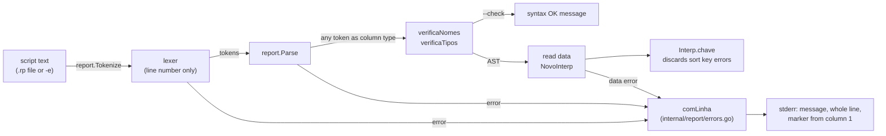
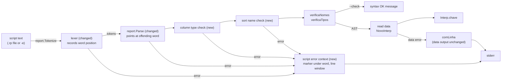

# SPEC: script-error-diagnostics

## Metadata
- Source: developer description via /plan
- Service: rptgo (module `rptgo`, Go 1.25, stdlib only; verified at `go.mod`)
- Tier: standard
- Version: 1.1
- Architecture references: `AGENTS.md`, `docs/agents/architecture.md`, `docs/agents/domain_rules.md`, `.claude/rules/bc-harness.md` (also consulted: `docs/agents/coding_guidelines.md`, `docs/agents/api_contracts.md`)
- Baseline: the working tree, including the uncommitted `-e` / `--script` feature (`.spec/features/inline-script-option/SPEC.md`)

## Context
Script mistakes in `rptgo`, in `.rp` files and in `-e` text, are either silent or hard to locate. Behaviour reproduced on the baseline:

- `input a [numerc] end` passes `--check`: any token after `[` is stored as the column type (verified at `internal/report/parser.go:225-228`) and an unlisted type is read as text (verified at `internal/report/interp.go:116-166`). `[10]` is accepted the same way.
- `sort idades` produces an unsorted report with exit 0: the error from evaluating a sort key is discarded (verified at `internal/report/interp.go:762-768`).
- The `^` marker always starts under the first column of the source line and spans the trimmed line length, capped at 40 (verified at `internal/report/errors.go:27-42`).
- Several parser errors are raised after the offending token was consumed, so they show the next token or the next line (verified at `internal/report/parser.go:220-224`, `286-298`). A repeated `detail` on line 4 is reported on line 5 (`REFERENCIA.md:1958-1963`).
- `input a,` followed by `end` consumes `end` as a column name and reports `falta o 'end' que termina o script` on a line past the end of the script, with no source line (verified at `internal/report/parser.go:219-248`, `202-204`).
- `expressão inválida` does not say what was found (verified at `internal/report/parser.go:772`).

Applicable architecture rules:
- Script syntax belongs to the `report` lexer/parser/ast layer and the static type check to `report` tipos; `cmd/rptgo` does not own script parsing (`docs/agents/architecture.md`, "Layer responsibilities").
- Interpreter errors use `Erro`, `ErroLinhaScript` and `ErroLinhaDados`; the line variants print the source line and a `^` marker (`docs/agents/coding_guidelines.md`, `internal/report/errors.go`). The marker routine is shared by script and data errors, so data output must be protected (RF-08).
- Input typing, sorting and named expressions follow `docs/agents/domain_rules.md` ("Input typing", "Named expressions and break levels").

Documentation language: `.claude/rules/bc-harness.md` asks for pt-BR docs to be translated when next touched. Keeping `README.md` and `REFERENCIA.md` in pt-BR is a planning assumption, not confirmed by the developer; translation stays out of scope.

## AS IS — Estado atual



Tokens carry only a line number, unknown column types and unknown sort names pass parsing, and one routine draws the marker for both script and data errors.

## TO BE — Estado proposto



The changed lexer and the new script error context realize RF-03, RF-04, RF-05 and CT-01; the changed parser realizes RF-03 and RF-06. The new column type check realizes RF-01, the new sort name check realizes RF-02, and the separate data error path realizes RF-08.

## Scope
- **In**: rejecting unknown column types; rejecting unknown names, nonexistent function names and aggregates in `sort`; the extra comma hint for `input`; marker position, long-line window, tab and multibyte alignment for lexer and parser errors and for the two new errors; wording of the missing-`end` and invalid-expression errors; the `REFERENCIA.md` blocks and statements affected by these changes.
- **Out**:
  - Data errors (`ErroLinhaDados`): message, source line and marker.
  - Execution errors, and errors printed without a source line today (missing `input`, named-expression conflicts, `before`/`after` of a nonexistent sort level).
  - Static type check errors from `internal/report/tipos.go` (for example `a condição do 'if' precisa ser uma expressão lógica`): their output stays as today. This reads "lexer/parser" in the confirmed criteria literally, matching the layer split in `docs/agents/architecture.md`.
  - Unknown names and nonexistent function names outside `sort` keys and the named expressions they refer to (in `print`, `if`, `set`, aggregates), which remain execution errors.
  - Reporting more than one error per run.
  - Display-width handling of East Asian wide and combining characters; alignment is counted per Unicode code point.
  - New command-line options.
  - Translating existing pt-BR docs.
  - Hand edits to `AGENTS.md` or `docs/agents/*`.

## RIGID (Non-Negotiable)

Terms used below:
- **Script error**: an error raised by the lexer or the parser, plus the errors of RF-01 and RF-02.
- **Offending word**: the source text that the error is about, as defined in RF-03.
- **Position**: counted in Unicode code points of the decoded script text.

### Functional Requirements

- RF-01 [Unwanted]: If a column in `input` has, after `[`, a type that is not one of `string`, `text`, `numeric`, `integer`, `long`, `int`, `float`, `amount`, `double`, `real`, `huge`, `date`, `ldate`, `time`, `bool` (list verified at `REFERENCIA.md:365`; handling verified at `internal/report/interp.go:16-17` and `109-166`), then the system shall report a script error naming the column and the type found and listing the valid types, and exit with code 1.
  - AC: `input nome, valor [numerc] end` exits 1; stderr contains `valor`, `numerc` and each of the 15 valid type names; the marker is under `numerc`; stdout is empty.
  - AC: The same script with `--check` or `-r` produces the same stderr and exit code, and stdout does not contain `Script sem erros de sintaxe.`.
  - AC: With a nonexistent data file as argument, the error is the type error, and nothing is read from standard input.
  - AC: A number in the type position (`input a [10] end`) is rejected the same way, naming `a` and `10`.
  - AC: Each of the 15 valid types, in lower case and in upper case, with and without a following size, is accepted; a column without `[...]` stays `string`.

- RF-02 [Unwanted]: If a `sort` key refers, directly or through named expressions, to a name that is not valid for `sort`, to a nonexistent function or to an aggregate (`count`, `total`, `avg`, `min`, `max`), then the system shall report a script error naming that name or function, before reading any data, and exit with code 1; for an aggregate, the message shall also say that aggregates cannot be used in `sort`.
  - Function rules decided by the planning assistant, not confirmed by the developer. Existing non-aggregate functions (`dow`, `mdy`, `index`, dispatch verified at `internal/report/interp.go:432-461`) and the `substr` operator stay accepted. The marker is under the function name.
  - Valid names (all resolved today, verified at `internal/report/interp.go:195-214`): an `input` column; a named expression `<name> expr` declared in `sort` or in any `print`, wherever it appears in the script; a variable assigned by `set` anywhere in the script. The built-ins `today`, `hour`, `pageno` and the constant `null` (verified at `internal/report/parser.go:715-717`, `762-769`) stay accepted.
  - AC: `input idade [numeric] sort idades end` exits 1; stderr contains `idades`; the marker is under `idades`.
  - AC: The same script with `--check` or `-r` produces the same stderr and exit code.
  - AC: Without `--check`, with a nonexistent data file as argument, the error is the sort error; with data on standard input, standard input is not read; no `-o` file is created. This holds for `--format text`, `csv`, `json` and `html`.
  - AC: An unknown name nested in a key (`sort <k> idade + idadez`), in a `desc` key, in a second key, inside a function argument, or inside a named expression that a key refers to (`sort k` with `print <k> zz`) is reported by that name.
  - AC: `sort <x> x`, where `x` is not otherwise a valid name, is reported as unknown name `x`.
  - AC: Each of these is accepted and gives the same output as on the baseline: a column; `<mes> mdy(data, 0)`; a key naming an expression declared later in a `print`; a key naming a `set` variable, including its `before` / `after` breaks; `<g> g` where `g` is a column; a key using `today`, `hour`, `pageno` or `null`.
  - AC: `input a sort foo(a) end` exits 1; stderr contains `foo`; the marker is under `foo`.
  - AC: For each of `count`, `total`, `avg`, `min`, `max` used in a sort key (including `count(*)`), the script exits 1; stderr contains the function name and says that aggregates cannot be used in `sort`; the marker is under the function name.
  - AC: A nonexistent function or an aggregate inside a named expression that a sort key refers to (`sort k` with `print <k> foo(a)` or `print <k> total(a)`) is reported the same way, with the marker under the function name where it is written.
  - AC: The function and aggregate errors give the same stderr and exit code with and without `--check`; without `--check`, with a nonexistent data file as argument, they are reported and no data is read.
  - AC: Sort keys using `dow`, `mdy`, `index` or `substr` are accepted and give the same output as on the baseline.
  - AC: An aggregate that no sort key refers to, directly or through named expressions, stays accepted as on the baseline.

- RF-03 [Event-driven]: When a script error with a source line is reported, the system shall print the source line that contains the offending word, report that line's number, and place the `^` marker under the offending word.

  | Error | Offending word |
  |---|---|
  | `caractere não reconhecido` | that character |
  | `string não terminada`, `string deve estar numa única linha` | from the opening quote to the last non-blank character of that line |
  | `comentário não terminado`, `comentário precisa abrir e fechar na mesma linha` | from `/*` to the last non-blank character of that line |
  | repeated section | the section keyword of the repeated occurrence |
  | name already given to another expression | the name between `<` and `>` |
  | invalid `substr` range or non-integer bound | the non-integer bound; for an invalid range, the `substr` keyword |
  | invalid time or date literal (the date error, for example `1/123/2000`, carries no line today, `internal/report/parser.go:694-697`) | the literal |
  | unknown column type (RF-01) | the type found |
  | unknown sort name (RF-02) | the unknown name |
  | nonexistent function or aggregate in `sort` (RF-02) | the function name |
  | any other parser error (`esperado ...`, `... esperado`, `esperada uma constante inteira`, `instrução inválida`, `expressão inválida`) | the word that was found where something else was required |
  | any parser error where the end of the script was found | the last word of the script, on its line |

  - AC: For each row, a test with the offending word preceded by other text on the same line (or by indentation) shows the first `^` at the position of the word's first character, and the number of `^` equals the word's length (string literals include their quotes), subject to clipping under RF-04.
  - AC: When the rejected word is the last one on its line and the following lines hold more words, the line number and source line are those of the rejected word, for `nome de coluna esperado no input`, `nome da seção esperado`, `nome de variável esperado` and `'footer' ou 'header' esperado`.
  - AC: A script with `detail` on lines 2 and 4 reports `linha 4`, shows line 4, and marks `detail`.
  - AC: Errors found at the end of a script that ends with one or more newlines, blank lines or comments show the line of the last word, never a line number past it and never a message without a source line.
  - AC: An empty script, or one holding only blanks and comments, exits 1 with a message and no source line.
  - AC: The same script text produces byte-identical stderr from a `.rp` file and from `-e`.

- RF-04 [State-driven]: While the source line of a script error is longer than 72 code points (the window width), the system shall print an excerpt of that line that contains the start of the offending word, indicate with `...` each side on which text was omitted, and keep the marker under the offending word.
  - Window width decided by the planning assistant, not confirmed by the developer: at most 72 code points of source, excluding the `...` indicator on each cut side.
  - AC: For an offending word near the start, in the middle and at the end of a line longer than 72 code points, the excerpt holds at most 72 code points of source (the indicators not counted), contains the word's first character, and the first `^` is under it.
  - AC: A side with omitted text shows `...`; a side with no omitted text does not.
  - AC: A word longer than the window is shown from its first character, and the `^` run ends no later than the excerpt.
  - AC: A line of 72 code points or fewer is printed whole, with no indicator.
  - AC: A trailing carriage return of a CRLF script is neither counted nor printed.

- RF-05 [Ubiquitous]: The system shall keep the script error marker visually aligned on lines that contain tab characters or multibyte characters.
  - AC: With tabs before the offending word, the marker line has a tab at every position where the printed source line has a tab before the word, or neither line contains a tab there; in both cases the first `^` falls under the word's first character in a terminal, for any tab stop size.
  - AC: With accented or other multibyte non-wide characters (for example `São`, `ç`) before the offending word, the code point offset of the first `^` equals that of the word's first character in the printed lines.
  - AC: Both ACs hold on lines cut under RF-04, and for scripts read with `--encoding utf-8`, `latin-1` and `cp850`.

- RF-06 [Event-driven]: When the parser reports a missing `end` or an invalid expression, the system shall state in the message what was found and where reading stopped. When parsing fails after a trailing comma made `input` consume a keyword (for example `end`, `sort`, `detail`, `width`) as a column name, the system shall also state in the message that the word was read as an `input` column name and that there may be an extra comma.
  - Extra comma hint decided by the planning assistant, not confirmed by the developer. The hint adds to the message of whatever parser error results (for example a missing `end` or `instrução inválida fora de seção`); the line and marker of that error follow RF-03.
  - AC: The missing-script-`end` message still contains `falta o 'end' que termina o script`, states that the end of the script was reached, quotes the last word read as written in the script, reports its line number, and shows that line with the marker under that word.
  - AC: The missing-block-`end` message still contains `falta 'end' do bloco 'begin'`, states that the end of the script was reached, quotes the last word read, and gives the line number of the unclosed `begin`.
  - AC: The invalid-expression message still contains `expressão inválida` and quotes the word found; when the end of the script was found, it says so and quotes the last word read.
  - AC: `print a, ,` followed by a newline and `end` quotes the second `,` and marks it.
  - AC: `input a,` followed by a newline and `end` exits 1; the message reports line 2, quotes `end` and shows line 2.
  - AC: A column named after a keyword (for example `date`, `end`, `sort`) stays accepted in `input` as on the baseline (rule at `REFERENCIA.md:306-310`).
  - AC: For `input a,` followed by a newline and `end`, the message also says that `end` was read as an `input` column name and that there may be an extra comma.
  - AC: For `input a,` followed by `sort a` and `end` on separate lines, the script exits 1 and the message, besides the resulting parser error, says that `sort` was read as an `input` column name and that there may be an extra comma.
  - AC: A valid script with keyword-named columns, including one whose last column follows a comma, produces the same stdout, output file, stderr and exit code as on the baseline, with no hint.

- RF-07 [State-driven]: While a script is valid under RF-01 and RF-02, the system shall produce the same stdout, output file, stderr and exit code as the baseline.
  - AC: For every script under `examples/` and `internal/report/testdata/golden/`, `--check` exits 0.
  - AC: All golden baselines and all `<!-- expect -->` and `<!-- output -->` blocks pass without changes to their expected text.
  - AC: `--check` on a valid script prints exactly `Script sem erros de sintaxe.` and a newline (verified at `cmd/rptgo/main.go:105`).

- RF-08 [Ubiquitous]: The system shall keep data error output unchanged.
  - AC: The invalid-value and field-count blocks of `REFERENCIA.md` (`1875-1880`, `1898-1903`) pass without edits.
  - AC: For a data line longer than the window width, indented, or holding tabs, stderr is byte-identical to the baseline: whole line, marker from the first column, capped at 40.

### Contracts

- CT-01: Script error output on stderr, exit code 1 (current shape verified at `internal/report/errors.go:27-57` and `cmd/rptgo/main.go:93-102`).

  ```text
  rptgo: linha N: <message in pt-BR>
    N | <source line or excerpt>
        <blank or tab padding>^^^^
  ```

  The `rptgo: ` program prefix, the `linha N: ` prefix and the `  N | ` source prefix are unchanged. Exit codes are unchanged: 1 for script errors, 2 for usage errors.

### Non-Functional Requirements

- RNF-01: The feature adds 0 external dependencies: `go.mod` has no `require` directive and no `go.sum` file exists.
- RNF-02: `go test ./...` exits 0 with 0 failing tests; existing tests, including those of the `-e` baseline, pass, and changes to expected values are limited to script error output required by RF-01 to RF-06.
- RNF-03: 100% of new identifiers, code comments and user-facing strings are in pt-BR; additions to `README.md` and `REFERENCIA.md` are in pt-BR (planning assumption for the two docs, see Context).
- RNF-04: Every marked block in `README.md`, `REFERENCIA.md`, `SAIDA-HTML.md` and `examples/*/README.md` matches the real output (`go test ./cmd/rptgo -run 'Readme|Referencia'` exits 0), and 0 statements in `README.md` or `REFERENCIA.md` contradict RF-01 to RF-06.
- RNF-05: The implementation diff contains 0 hand edits to `AGENTS.md` and `docs/agents/*`.

## FLEXIBLE (Implementation Suggestions)
- Add a column (rune offset) and source length to `report.Token`; build script errors from a token instead of a line number, and keep `comLinha` as it is for data errors.
- Give the EOF token the position of the last real token, or have the error helper fall back to it.
- In `pInput`, `pSort`, `stmt` and `pEvento`, check the token with `pk(0)` before consuming it, or pass the consumed token to the error helper.
- Keep one set of valid column types in `internal/report` and derive the message list from it; `cmd/rptgo/entrada.go:149-150` holds a separate numeric subset.
- Run the sort name check at the end of `Parse`, after `coletarVariaveis` and once all named expressions are known. Record name positions during `pSort` and `pPrint` (side table or a position field on `ColExpr`; note that `registraNome` compares expressions with `reflect.DeepEqual`, so a position inside the AST would break repeated identical names). Guard the walk against self-referencing names.
- Tabs: copy each tab of the printed prefix into the marker line, or replace tabs by one space in both lines.
- `REFERENCIA.md:1958-1963` changes with RF-03. Section 12 can gain verified examples for the two new errors, and sections 3 and 4 can state that unknown types and unknown sort names are errors. The comment above `tipoDeV` and the one in `Interp.chave` should be re-read for accuracy.
- After the code change, re-run `/bc-harness:ai-context` so the generated docs reflect the new errors.

## Acceptance Criteria Summary
| ID | Criterion | Testable? |
|----|-----------|-----------|
| RF-01 | Unknown column type is an error naming column and type and listing valid types, also under `--check` | Yes |
| RF-02 | Unknown name, nonexistent function or aggregate in `sort` is an error before data is read, also under `--check`; valid names and functions keep working | Yes |
| RF-03 | Marker under the offending word, with its line number | Yes |
| RF-04 | Script lines longer than 72 code points show a window with aligned marker | Yes |
| RF-05 | Alignment holds with tabs and multibyte characters | Yes |
| RF-06 | Missing `end` and invalid expression say what was found and where; a trailing comma in `input` adds an extra comma hint | Yes |
| RF-07 | Valid scripts unchanged | Yes |
| RF-08 | Data error output unchanged | Yes |
| CT-01 | Script error shape and exit codes | Yes |
| RNF-01 | 0 external dependencies | Yes |
| RNF-02 | `go test ./...` exits 0 | Yes |
| RNF-03 | pt-BR identifiers, comments, strings and doc additions | Yes (review) |
| RNF-04 | Marked doc blocks verified | Yes |
| RNF-05 | 0 hand edits to generated agent docs | Yes |
