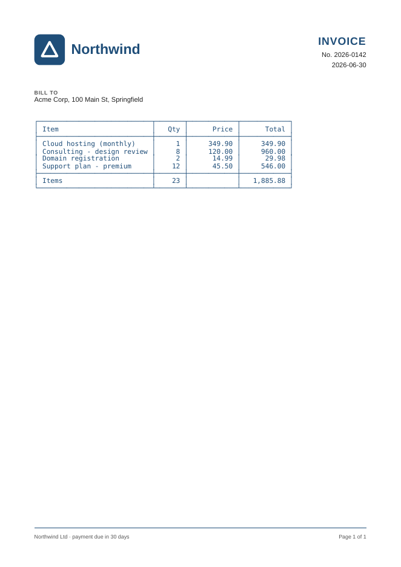

# rptgo

**Dados em arquivos de texto, relatórios de verdade.** Descreva num script curto como os dados
devem ser ordenados, agrupados e totalizados, e o `rptgo` entrega o relatório: texto paginado
para impressora, **PDF com logo e layout**, CSV ou JSON, a partir da mesma definição.



**Documentação:** [Referência da linguagem](REFERENCIA.md) · [Exemplos](#exemplos) · [Saída HTML e caixas](SAIDA-HTML.md)

## Para que serve

Você tem dados em arquivos de texto: um arquivo separado por delimitador, o CSV exportado do
Excel, um JSON, a saída de outro programa ou de uma consulta ao banco. E precisa de um
relatório com **layout**: colunas alinhadas, cabeçalho e rodapé por página, **várias quebras
em cascata** (grupo, subgrupo, item) e **totais, contagens e médias em cada nível**. Escrever
isso à mão em código é trabalhoso; o `rptgo` faz com um script declarativo de poucas linhas,
numa linguagem declarativa de relatórios (seções `input`, `sort`,
`before`, `after`, `detail`).

```
 fontes de dados            script .rp                          saídas
 ┌────────────────────┐   ┌────────────────────┐
 │ texto com |        │   │ input   (colunas)  │
 │ CSV (do Excel)     │──▶│ sort    (ordem)    │
 │ JSON               │   ├────────────────────┤ ──────────▶  texto paginado (matricial)
 └────────────────────┘   │ before / after     │ ─▶ template ▶  PDF / HTML com logo e caixas
                          │ detail  (layout)   │
                          └────────────────────┘
```

- **Várias fontes, um mesmo script:** texto com `|` (ou o `separator` do script), CSV com
  aspas e qualquer delimitador, inclusive o do Excel brasileiro (`;` e decimal com vírgula), e
  JSON (`--input`). O `input` do script diz o tipo de cada coluna, então datas, números e
  `bool` seguem as mesmas regras em qualquer fonte.
- **Layout para impressão:** o layout do script (`before`/`after`/`detail`) gera o relatório
  paginado e o PDF (`--format text|html`). Também dá para exportar os dados, sem layout, em CSV
  ou JSON (`--format csv|json`), na ordem do `sort`.
- **Quebras em cascata e acumuladores:** `before`/`after` em cada nível do `sort`, com `count`,
  `total`, `avg`, `min` e `max`, inclusive filtrados (`total(salary where active)`).
- **Layout em colunas:** `print ... in col N using 'máscara'`, datas, moldes numéricos,
  texto quebrado por largura e caixas desenhadas com `+---+` (`--box`).
- **PDF sem sair do terminal:** `--format html` junta o relatório a um template com logo e
  variáveis; o navegador imprime em PDF.
- **Um binário só**, em Go, sem dependências.

## Linha de comando

```sh
go build -o rptgo ./cmd/rptgo     # um binário estático, sem dependências
./rptgo [opções] script.rp [dados.txt | -]
```

Sem o arquivo de dados (ou com `-`), lê da entrada padrão. Todas as opções estão na ajuda:

<!-- run -->
```sh
./rptgo --help
```
<!-- expect -->
```text
Uso: rptgo [OPÇÃO]... SCRIPT.rp [ENTRADA.txt | -]

Executa um script de relatório (.rp) sobre um arquivo de dados (texto com campos separados
por '|', CSV ou JSON) e escreve o relatório paginado, PDF/HTML, CSV ou JSON.
Sem ENTRADA.txt, ou com '-', lê os dados da entrada padrão.

Opções:
  -o, --saida, --output ARQUIVO  grava no ARQUIVO em vez da saída padrão
      --format FORMATO           formato da saída: text (padrão), csv, json ou html;
                                 csv, json e html não combinam com --form-feed
      --encoding CODIFICAÇÃO     leitura e escrita: utf-8 (padrão), latin-1 ou cp850
      --header MODO              1ª linha dos dados é cabeçalho: auto (padrão),
                                 sim ou nao
      --form-feed                separa páginas com \f em vez de completar com linhas
                                 em branco até o 'length' do script
      --newline MODO             fim de linha: auto (padrão), lf ou crlf
      --box                      troca caixas ASCII (+---+ e |) por caracteres de desenho
                                 de linha; com --format text (utf-8 ou cp850) ou html
      --strict                   comentários /* */ abrem e fecham na mesma linha; com
                                 'before report', o 'header' não roda na 1ª página
                                 e 'today' imprime o ano com 2 dígitos

Fonte dos dados (padrão: texto com campos separados por '|', ou pelo 'separator' do script):
      --input FONTE              delimited (padrão), csv ou json. csv lê aspas do RFC 4180;
                                 json lê um array de objetos (ou um objeto por linha) e liga
                                 cada coluna do input à chave de mesmo nome
      --input-delimiter CARACTERE  delimitador do CSV de entrada: ; , | tab ou auto (padrão: detecta
                                 pelo número de colunas do input; aspas são sempre aceitas)
      --input-decimal CARACTERE  separador decimal dos números na entrada: . (padrão), , ou auto
                                 (com , lê 1.250,50 e R$ 1.250,50 como 1250.50; auto escolhe pelos
                                 valores; em JSON vale só para valores entre aspas);
                                 CSV do Excel brasileiro: --input csv --input-decimal auto
                                 --encoding latin-1

Opções de --format csv (padrão: RFC 4180, vírgula, aspas só quando necessárias):
      --csv-delimiter CARACTERE  delimitador dos campos: ; | tab ... (padrão: vírgula)
      --csv-quote MODO           minimal (padrão), strings (todo texto e o cabeçalho entre
                                 aspas) ou all (todos os campos)
      --csv-decimal CARACTERE    separador decimal dos números: . (padrão) ou ,
      --csv-no-header            não escreve a linha de cabeçalho

Opções de --format html (a saída é sempre UTF-8, sem linhas em branco de preenchimento):
      --template ARQUIVO         modelo HTML (padrão: folhas A4 embutidas)
      --var NOME=VALOR           define {{NOME}} no modelo; pode repetir
      --logo ARQUIVO             imagem (png, jpg, gif, svg, webp) em {{Logo}}
      --title TEXTO              {{Title}} (padrão: nome do script)
      --lines N                  linhas de texto por página (padrão: length - margens
                                 superior e inferior do script)
  Modelo: {{#Pages}}...{{/Pages}} repete por página. Variáveis: Title, Script, Date, Time,
  Columns, PageCount, Logo, as de --var e, dentro do bloco, PageNumber e Text.

Outras opções:
  -r, --check                    só verifica a sintaxe do script, sem gerar relatório
  -h, --help                     mostra esta ajuda e sai

Variáveis de ambiente: DATEFMT, CENTURY_CUTOFF, TIMEFMT, WIDTH, PAGELN, SEPARATOR,
RADIXSEP, CURRSYM e RPT_NOW (fixa o relógio, ex.: 2026-11-24 17:47).

Código de saída: 0 sucesso; 1 erro no script, nos dados ou de E/S; 2 uso inválido.

Exemplos:
  rptgo relatorio.rp dados.txt > relatorio.txt
  rptgo --format json relatorio.rp dados.txt
  cat dados.txt | rptgo -o saida.txt relatorio.rp -
  rptgo --format csv --csv-delimiter ';' --csv-quote strings --csv-decimal ',' relatorio.rp dados.txt
  rptgo --format html --box --template modelo.html --logo logo.svg relatorio.rp dados.txt > saida.html
```

## Exemplos

Cada exemplo é uma página com o **script**, os **dados**, o **comando** e o **resultado**, e todos são
conferidos por testes. Os arquivos ficam em [`examples/`](examples/).

| Exemplo | O que mostra |
|---|---|
| [Vendas por região e mês](examples/relatorio-vendas-regiao/README.md) | quebra em dois níveis com chave calculada; a mesma venda em texto, CSV, JSON e CSV do Excel; exportar para CSV/JSON; desempenho das fontes |
| [Folha de pagamento por departamento](examples/payroll-by-department/README.md) | `if` com coluna `bool`, `where` nos agregados, PDF |
| [Pedidos de compra](examples/purchase-orders/README.md) | cliente > pedido > itens com subtotais, marcas condicionais e PDF com paginação |
| [Fatura com logo e caixas](examples/invoice-html/README.md) | `--box`, template HTML, logo e variáveis, PDF |
| [Feriados do ano, com um curl](examples/feriados-brasil/README.md) | o JSON de uma API vira o relatório, numa linha |
| [Estoque por categoria e subcategoria](examples/relatorio-estoque-categoria/README.md) | duas quebras com `count`, `total` e `avg` |
| [Cadastro de clientes](examples/cadastro-clientes/README.md) | datas, `bool` e nulos; saída em CSV e JSON |
| [Contas a receber](examples/invoice-aging/README.md) | aritmética de datas e faixas de atraso |

## Estrutura

```
cmd/rptgo/          interface de linha de comando (entrada, saídas, ajuda)
internal/report/    interpretador: léxico, parser, tipos, execução, máscaras, datas
examples/           um exemplo por pasta, cada um com a sua página (README.md)
REFERENCIA.md       referência da linguagem, com exemplos conferidos por testes
SAIDA-HTML.md       saída HTML/PDF: modelo, variáveis, logo e caixas
scripts/            render-readme-images.sh gera as imagens (docs/images)
```
