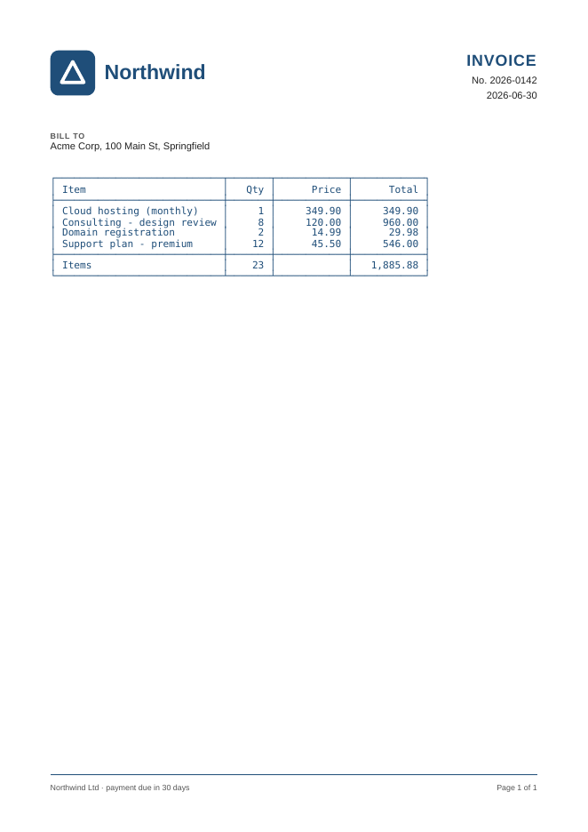

# Fatura com logo, caixas e template próprio

[← Exemplos](../../README.md#exemplos) · [Referência da linguagem](../../REFERENCIA.md)

O script desenha a tabela com `+---+` e `|`. A opção `--box` troca esses caracteres por caracteres de
linha, e um template HTML (`{{Title}}`, `{{Logo}}`, `{{Text}}`...) coloca o logo, o cabeçalho e o
rodapé. Todas as opções do HTML estão em [Saída HTML e caixas](../../SAIDA-HTML.md).

## O script

<!-- file: examples/invoice-html/report.rp -->
```text
/* Invoice lines drawn with ASCII boxes (+---+ and |). Run with --box to get line-drawing
   characters, and with --format html --template template.html for the printable page. */
input
   item   [string 26],
   qty    [numeric 6],
   price  [amount 10]

width 70
length 40
sort item

before report
   print '+----------------------------+-------+------------+------------+'
   print '| Item                       |   Qty |      Price |      Total |'
   print '+----------------------------+-------+------------+------------+'

detail
   print '|' in col 1, item in col 3, '|' in col 30, qty in col 32 using '####&', '|' in col 38, price in col 40 using '###,##&.&&', '|' in col 51, qty * price in col 53 using '###,##&.&&', '|' in col 64

after report
   print '+----------------------------+-------+------------+------------+'
   print '|' in col 1, 'Items' in col 3, '|' in col 30, total(qty) in col 32 using '####&', '|' in col 38, '|' in col 51, total(qty * price) in col 53 using '###,##&.&&', '|' in col 64
   print '+----------------------------+-------+------------+------------+'
end
```

## Os dados

<!-- file: examples/invoice-html/data.txt -->
```text
Consulting - design review|8|120.00
Cloud hosting (monthly)|1|349.90
Support plan - premium|12|45.50
Domain registration|2|14.99
```

## Só o texto, com as caixas convertidas

<!-- run -->
```sh
./rptgo --box examples/invoice-html/report.rp examples/invoice-html/data.txt
```
<!-- expect -->
```text


  ┌────────────────────────────┬───────┬────────────┬────────────┐
  │ Item                       │   Qty │      Price │      Total │
  ├────────────────────────────┼───────┼────────────┼────────────┤
  │ Cloud hosting (monthly)    │     1 │     349.90 │     349.90 │
  │ Consulting - design review │     8 │     120.00 │     960.00 │
  │ Domain registration        │     2 │      14.99 │      29.98 │
  │ Support plan - premium     │    12 │      45.50 │     546.00 │
  ├────────────────────────────┼───────┼────────────┼────────────┤
  │ Items                      │    23 │            │   1,885.88 │
  └────────────────────────────┴───────┴────────────┴────────────┘
```

## A fatura em PDF

O template [`template.html`](template.html), o logo [`logo.svg`](logo.svg) e as variáveis passadas na
linha de comando:

<!-- run-only -->
```sh
./rptgo --format html --box \
  --template examples/invoice-html/template.html --logo examples/invoice-html/logo.svg \
  --var Company="Northwind Ltd" --var Invoice=2026-0142 \
  --var BillTo="Acme Corp, 100 Main St, Springfield" --var Footer="payment due in 30 days" \
  examples/invoice-html/report.rp examples/invoice-html/data.txt > invoice.html
```

```sh
google-chrome --headless --no-pdf-header-footer --print-to-pdf=invoice.pdf invoice.html
```

O [`run.sh`](run.sh) faz isso de uma vez (e já escolhe o Chrome instalado). O resultado:


