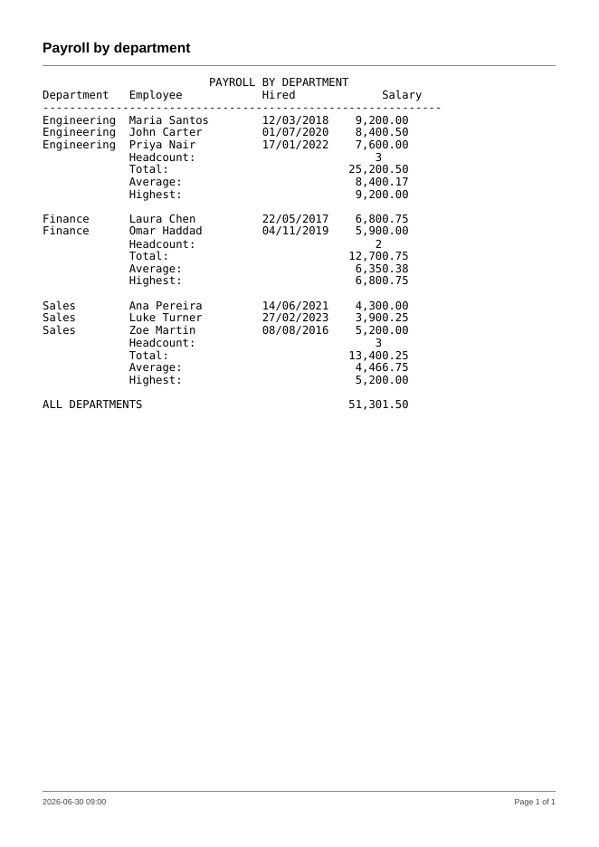

# Folha de pagamento por departamento

[← Exemplos](../../README.md#exemplos) · [Referência da linguagem](../../REFERENCIA.md)

Uma quebra (`dept`), só os funcionários ativos (`if active then`) e, no fim de cada departamento,
a quantidade, o total, a média e o maior salário, usando `where` nas funções de agregação. Mostra a coluna `bool`,
datas com ano de 4 dígitos (`ldate`) e as máscaras numéricas.

## O script

<!-- file: examples/payroll-by-department/report.rp -->
```text
/* Payroll by department: active employees only, with headcount, total, average and
   highest salary per department. Inactive employees stay in the data but are skipped. */
input
   dept      [string 12],
   employee  [string 18],
   hired     [ldate 10],
   active    [bool],
   salary    [amount 10]

width 72
length 40
sort dept

before report
   print 'PAYROLL BY DEPARTMENT' centered
   print 'Department' in col 1, 'Employee' in col 14, 'Hired' in col 34, 'Salary' in col 52
   print 60[-] in col 1

detail
   if active then
      print dept in col 1, employee in col 14, hired in col 34, salary in col 46 using '###,##&.&&'

after dept
   print 'Headcount:' in col 14, count(* where active) in col 46 using '#####&'
   print 'Total:' in col 14, total(salary where active) in col 46 using '###,##&.&&'
   print 'Average:' in col 14, avg(salary where active) in col 46 using '###,##&.&&'
   print 'Highest:' in col 14, max(salary where active) in col 46 using '###,##&.&&'
   skip

after report
   print 'ALL DEPARTMENTS' in col 1, total(salary where active) in col 46 using '###,##&.&&'
end
```

## Os dados

Campos separados por `|`; `active` aceita `yes`/`no` (e `1`/`0`, `true`/`false`).

<!-- file: examples/payroll-by-department/data.txt -->
```text
Engineering|Maria Santos|2018-03-12|yes|9200.00
Engineering|John Carter|2020-07-01|yes|8400.50
Engineering|Priya Nair|2022-01-17|yes|7600.00
Engineering|Tom Becker|2015-09-30|no|9800.00
Finance|Laura Chen|2017-05-22|yes|6800.75
Finance|Omar Haddad|2019-11-04|yes|5900.00
Finance|Sven Olsen|2012-02-13|no|7100.00
Sales|Ana Pereira|2021-06-14|yes|4300.00
Sales|Luke Turner|2023-02-27|yes|3900.25
Sales|Zoe Martin|2016-08-08|yes|5200.00
Sales|Ian Moore|2014-12-01|no|4800.00
```

## Executar e o resultado

<!-- run -->
```sh
./rptgo examples/payroll-by-department/report.rp examples/payroll-by-department/data.txt
```
<!-- expect -->
```text


                           PAYROLL BY DEPARTMENT
  Department   Employee            Hired             Salary
  ------------------------------------------------------------
  Engineering  Maria Santos        12/03/2018    9,200.00
  Engineering  John Carter         01/07/2020    8,400.50
  Engineering  Priya Nair          17/01/2022    7,600.00
               Headcount:                           3
               Total:                           25,200.50
               Average:                          8,400.17
               Highest:                          9,200.00

  Finance      Laura Chen          22/05/2017    6,800.75
  Finance      Omar Haddad         04/11/2019    5,900.00
               Headcount:                           2
               Total:                           12,700.75
               Average:                          6,350.38
               Highest:                          6,800.75

  Sales        Ana Pereira         14/06/2021    4,300.00
  Sales        Luke Turner         27/02/2023    3,900.25
  Sales        Zoe Martin          08/08/2016    5,200.00
               Headcount:                           3
               Total:                           13,400.25
               Average:                          4,466.75
               Highest:                          5,200.00

  ALL DEPARTMENTS                               51,301.50
```

## Em PDF

O mesmo script gera HTML (modelo A4 embutido) com `--format html`, e o navegador imprime em PDF:

<!-- run-only -->
```sh
./rptgo --format html --title "Payroll by department" examples/payroll-by-department/report.rp examples/payroll-by-department/data.txt > payroll.html
```


