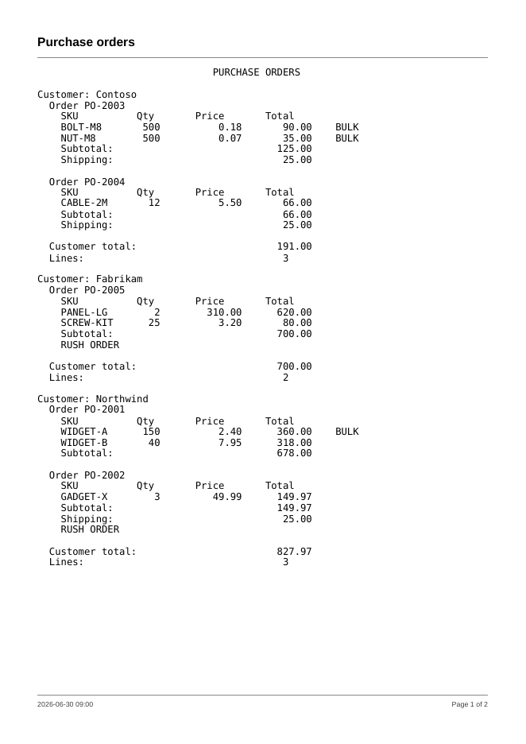

# Pedidos de compra: cliente > pedido > itens

[← Exemplos](../../README.md#exemplos) · [Referência da linguagem](../../REFERENCIA.md)

Duas quebras em cascata, com subtotal por pedido, total por cliente e total geral. Mostra marcas
condicionais (`BULK` para 100 unidades ou mais, `RUSH ORDER`), frete para pedidos pequenos e a saída
em PDF com paginação.

## O script

<!-- file: examples/purchase-orders/report.rp -->
```text
/* Purchase orders: customer > order > line items. Line total is quantity * unit price,
   lines with 100 or more units are tagged BULK, and orders with a subtotal under 500.00
   show a flat shipping charge (listed, not included in the totals). */
input
   customer   [string 14],
   order_no   [string 8],
   sku        [string 10],
   quantity   [numeric 6],
   unit_price [amount 10],
   rush       [bool]

width 76
length 50
sort customer, order_no

before report
   print 'PURCHASE ORDERS' centered
   skip

before customer
   print 'Customer: ' + customer in col 1

before order_no
   print 'Order ' + order_no in col 3
   print 'SKU' in col 5, 'Qty' in col 18, 'Price' in col 28, 'Total' in col 40

detail
   print sku in col 5, quantity in col 16 using '#####&', unit_price in col 26 using '###,##&.&&', quantity * unit_price in col 38 using '###,##&.&&' no newline
   if quantity >= 100 then print 'BULK' in col 52 else print ''

after order_no
   print 'Subtotal:' in col 5, total(quantity * unit_price) in col 38 using '###,##&.&&'
   if total(quantity * unit_price) < 500 then print 'Shipping:' in col 5, 25.00 in col 38 using '###,##&.&&'
   if count(* where rush) > 0 then print 'RUSH ORDER' in col 5
   skip

after customer
   print 'Customer total:' in col 3, total(quantity * unit_price) in col 38 using '###,##&.&&'
   print 'Lines:' in col 3, count(*) in col 38 using '#####&'
   skip

after report
   print 'ALL ORDERS' in col 1, total(quantity * unit_price) in col 38 using '###,##&.&&'
end
```

## Os dados

<!-- file: examples/purchase-orders/data.txt -->
```text
Northwind|PO-2001|WIDGET-A|150|2.40|no
Northwind|PO-2001|WIDGET-B|40|7.95|no
Northwind|PO-2002|GADGET-X|3|49.99|yes
Contoso|PO-2003|BOLT-M8|500|0.18|no
Contoso|PO-2003|NUT-M8|500|0.07|no
Contoso|PO-2004|CABLE-2M|12|5.50|no
Fabrikam|PO-2005|PANEL-LG|2|310.00|yes
Fabrikam|PO-2005|SCREW-KIT|25|3.20|yes
```

## Executar e o resultado em texto

<!-- run -->
```sh
./rptgo examples/purchase-orders/report.rp examples/purchase-orders/data.txt
```
<!-- expect -->
```text


                                PURCHASE ORDERS

  Customer: Contoso
    Order PO-2003
      SKU          Qty       Price       Total
      BOLT-M8       500          0.18       90.00    BULK
      NUT-M8        500          0.07       35.00    BULK
      Subtotal:                            125.00
      Shipping:                             25.00

    Order PO-2004
      SKU          Qty       Price       Total
      CABLE-2M       12          5.50       66.00
      Subtotal:                             66.00
      Shipping:                             25.00

    Customer total:                        191.00
    Lines:                                  3

  Customer: Fabrikam
    Order PO-2005
      SKU          Qty       Price       Total
      PANEL-LG        2        310.00      620.00
      SCREW-KIT      25          3.20       80.00
      Subtotal:                            700.00
      RUSH ORDER

    Customer total:                        700.00
    Lines:                                  2

  Customer: Northwind
    Order PO-2001
      SKU          Qty       Price       Total
      WIDGET-A      150          2.40      360.00    BULK
      WIDGET-B       40          7.95      318.00
      Subtotal:                            678.00

    Order PO-2002
      SKU          Qty       Price       Total
      GADGET-X        3         49.99      149.97
      Subtotal:                            149.97
      Shipping:                             25.00
      RUSH ORDER

    Customer total:                        827.97
    Lines:                                  3


  ALL ORDERS                             1,718.97
```

## Em PDF

Gerar o HTML (modelo A4 embutido) e imprimir em PDF pelo navegador:

<!-- run-only -->
```sh
./rptgo --format html --title "Purchase orders" examples/purchase-orders/report.rp examples/purchase-orders/data.txt > purchase-orders.html
```

```sh
google-chrome --headless --no-pdf-header-footer --print-to-pdf=purchase-orders.pdf purchase-orders.html
```

Página 1 do PDF (o relatório tem 2 páginas, com cabeçalho, rodapé e numeração):


